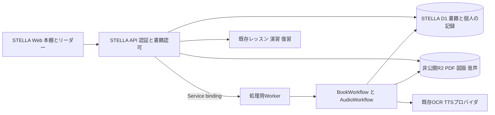

# STELLA 個人の本棚と書籍読み上げの統合設計

作成日 2026年10月11日  
状態 採用設計（実装状況は実装計画の12章を参照）  
[実装計画](book-library-implementation-plan.md)

STELLAに個人の本棚を追加し、PDFの章を読む・聴く体験から、関連レッスン、演習、復習へ進めるようにする。book-narratorのPDF分割、OCR、章分割、音声生成を移植し、ログイン、テナント、教材へのアクセス、学習の評価はSTELLAに統合する。

書籍の内容と、それぞれの利用者の本棚・再開位置・メモを別に持つ。同じ社内教材を使う場合も、読む順序や読書状態は個人で管理する。読了・再生終了は読書履歴であり、ステージのクリアやスキル習得を意味しない。

## 1 採用する構成

| 項目 | 採用案 | 理由 |
| --- | --- | --- |
| 利用者の入口 | STELLAの本棚、ホーム、レッスン | 再ログインや別アプリへの移動を求めない |
| 認証と認可 | STELLA APIの`getCaller`と書籍用の認可関数 | `profiles.id`、`tenantId`、無効化状態を全機能で一致させる |
| 書籍と個人の記録 | STELLAのD1に`library_*`テーブルを追加 | レッスンと同じ利用者・テナントを参照し、分散DB間の同期を避ける |
| 原本・図版・音声 | 新しい非公開R2バケット | 公開教材用のR2 URLから個人書籍を配信しない |
| OCRとTTS | 専用Workerと既存のWorkflows | PDF処理の依存関係と処理用設定を通常APIから分ける |
| Worker間の接続 | Service bindingsの専用entrypoint | ブラウザから処理Workerを直接呼ばせない |
| 処理状態の表示 | 初期版は認証付きAPIのポーリング | STELLAのJWTで利用でき、既存のCookie前提のWebSocketを移植せずに済む |
| LXPの関連付け | 章とステージ・レッスンを手動で関連付ける | 内容と利用可能性を確認してから推薦に使う |

処理WorkerはSTELLAモノレポに置く。既存book-narratorを外部アプリとして埋め込む方式は採用しない。Cookie認証、単一組織の共有判定、利用者DBをそのまま残すと、STELLAの所属・無効化・教材権限と一致しないためである。

CloudflareのService bindingsは名前付き`WorkerEntrypoint`に接続できる。この仕組みを使い、処理の開始と停止に必要なメソッドだけを公開する。[Service bindings RPCの仕様](https://developers.cloudflare.com/workers/runtime-apis/bindings/service-bindings/rpc/)



APIと処理Workerは同じD1をバインドする。処理WorkerのDBアクセスは書籍処理用リポジトリに閉じ、既存のステージ・評価テーブルを更新するメソッドを設けない。共有D1は独立したセキュリティ境界にはならないため、固定したRPC契約、テナント条件、認可テストでアクセス範囲を制御する。

既存のBookProgress Durable Objectは初期版の必須資源にしない。Workflowの通知処理を差し替え可能にし、状態はD1へ保存する。WebSocketの通知を追加する場合も、この状態を正本として再接続時に取り直す。

## 2 初期版の範囲

| 初期版に含める機能 | 内容 |
| --- | --- |
| 個人の本棚 | あとで読む、読書中、読み終えた、中断、個人タグ、検索、続きから再開 |
| PDF登録 | PCでの登録、複数PDF、自動分割、分割アップロード、失敗した送信の再試行 |
| 書籍の準備 | OCR、図版、章分割、処理状態、失敗した工程の再実行 |
| 読む・聴く | 章本文、原本ページ、図版、速度変更、シーク、章の連続再生、端末間の再開 |
| 個人の記録 | しおり、章・ページに付けるメモ、読了の自己記録 |
| 修正と出力 | 登録者によるOCR本文の修正、章の分割・結合、選んだ章・全章の音声生成、原本・本文・音声の出力 |
| LXP連携 | 個人の関連付け、社内教材の公式関連付け、関連レッスンへの移動、今日のプランへの追加 |
| 運用 | 利用量、概算費用、処理失敗、生成上限、削除と清掃、内部通知 |
| 社内教材 | 公開担当者が登録した自社著作物を、同一テナントの本棚に追加する |

最初に個人書籍で登録から再生までを通し、社内教材の公開機能はその後のPRで追加する。個人間の限定共有、AIによる関連章推薦、書籍への質問、確認問題の自動生成、EPUB・Webページ取り込み、オフライン再生は後続とする。book-narrator単体の限定共有機能は、STELLAのプロフィールによる認可へ移植するまで単体アプリ側で維持する。

初期版の入力はPDFに絞る。文字入りPDFも既存の処理経路で扱い、埋め込み文字の直接抽出によるOCR費用削減は別途検証する。書籍情報だけを登録する機能は後続に分け、PDF登録から読み上げまでの完成を優先する。

## 3 現状と再利用する実装

以下はローカルのソースで確認した実装と、統合時の変更点である。既存アプリの実装があることと、統合環境で本物の外部API・端末を検証済みであることは区別する。

| 現在の実装 | 再利用する内容 | 統合で変更する内容 |
| --- | --- | --- |
| book-narrator `src/web/lib/pdf-worker.ts`、`pdf-split.ts`、`upload.ts` | PDF確認、自動分割、分割送信、進捗 | STELLA API、Bearer認証、送信中断・再開状態 |
| `src/server/lib/pdf.ts`、`ocr.ts` | PDF描画、図版切り出し、OCR応答の正規化 | バケット、テナント、入力上限 |
| `src/server/lib/chapters.ts` | 見出しからの章分割、手動分割・結合 | 章の改訂と個人メモの参照保持 |
| `src/server/lib/speech.ts`、`mp3.ts` | 読み上げ対象の抽出、文分割、MP3変換 | プロバイダ設定、音声の改訂管理 |
| `src/server/providers.ts` | OCR・TTSの呼び出し、偽物のプロバイダ、利用量 | 秘密値の配置、テナント別利用上限 |
| `src/server/workflows/book.ts`、`audio.ts`、`jobs.ts` | 処理手順、途中結果、再試行、章ごとの生成待ち | `library_*`へのSQL変更、起動の冪等性、削除・改訂との競合 |
| `src/server/storage.ts` | R2キー生成、削除待ちと清掃 | テナント別キー、削除中の書き戻し防止 |
| `src/server/routes/*` | 登録、編集、検索、配信の処理 | `getCaller`、プロフィールによる共有、STELLAのエラー形式 |
| `src/web/components/Player.tsx` | 再生速度、位置保存、章送り、Media Session | 共通プレイヤー、メディア認証、競合しない再開位置 |
| `src/web/components/Markdown.tsx` | HTMLを実行しない本文表示、図版表示 | 認証付き画像取得、しおりと見出しID |
| book-narrator `test/*` | 処理、PDF分割、権限の回帰テスト | テナント、STELLA認証、変更したデータ構造のケース |
| STELLA `apps/web/src/lib/today-plan.ts` | 理由・所要時間を持つ今日のプラン | 書籍項目の識別子と選択状態 |
| STELLA `apps/api/src/lib/authz.ts` | JWT検証、利用者と所属の解決、無効化判定 | 書籍アクセスの追加 |

既存book-narratorは管理者ロールだけで個人書籍の本文を読める設計ではない。この性質を維持する。一方、現在の管理用メタ情報一覧とログに残す情報は、STELLAの個人本棚に合わせて減らす。

book-narratorの`users`、`sessions`、Google OIDCログイン、ドメイン・メールアドレスだけによる共有判定は移植しない。単体アプリのReact Routerも移植せず、STELLAのTanStack Router、共通シェル、UI部品に画面を組み込む。

## 4 コードの配置

```text
apps/web/src/
  routes/library*.tsx
  components/library/
  lib/library-api.ts
  lib/library-media.ts
  hooks/useLibrary*.ts
apps/api/src/
  routes/library*.ts
  lib/library-authz.ts
  db/schema.ts                     # library_*を追加
apps/api/drizzle/                  # マイグレーションの正本
apps/narrator/
  src/entrypoint.ts                # 固定RPC契約
  src/workflows/book.ts
  src/workflows/audio.ts
  src/maintenance.ts
  test/                           # Workers実環境のテスト
  wrangler.jsonc
packages/book-core/src/
  pdf/ ocr/ chapters/ speech/ mp3/
  providers/ repositories/ storage/
packages/shared/src/library/
  types.ts schemas.ts
```

`packages/book-core`には再利用する処理と書籍用リポジトリを置く。Web向け公開入口とWorker向け入口を分け、PDFium、WASM、MP3処理、プロバイダの秘密値をWebや通常APIのバンドルに混ぜない。必要な型と入力検証だけを`@stella/shared/library`で共有する。

書籍テーブルの定義とマイグレーションはSTELLA API側を正本にする。処理Worker用に別のD1マイグレーション履歴を作らない。既存のSQLを移植するリポジトリは、マイグレーションを実適用するテストで列・制約の一致を確認する。

## 5 データモデル

IDはSTELLAの既存規約に合わせる。利用者IDには`profiles.id`を使い、メールアドレスを主キーにしない。すべての書籍関連データにテナントを持たせ、所属が一致する親レコードを参照するよう複合制約とAPI検証を設ける。

| テーブル | 主な情報と制約 |
| --- | --- |
| `library_books` | `tenant_id`、`owner_id`、タイトル、著者、種別、公開範囲、公開状態、処理状態、処理世代、削除状態。所有者は同じテナントのプロフィール |
| `library_book_pdfs` | 原本・分割PDF、元ファイル名、順序、ページ数、原本内の位置、R2キー、upload ID。書籍内の順序を一意にする |
| `library_pages`、`library_figures` | OCR原文、ページ番号、図版とページ画像。ページ番号はアップロード順を含めて一冊内で連続させる |
| `library_chapters` | 章の順序、タイトル、Markdown、原本ページ範囲、本文の改訂ID、読み上げ対象のハッシュ |
| `library_chapter_revisions` | 修正前の本文、ページ範囲、変更理由。章分割・結合の前後も追えるようにする |
| `library_audios` | 章、改訂ID、読み上げハッシュ、モデル・声・分割設定、長さ、R2キー、生成状態 |
| `library_shelf_entries` | 利用者×書籍を一意にし、読書状態、個人タグ、本棚への追加・アーカイブ日時を保持する |
| `library_reader_states` | 利用者×章の本文位置と再生位置。本文改訂、音声改訂、version、再生セッションを区別する |
| `library_annotations` | 本人のしおり・メモ、章・ページ・見出し参照、元の改訂。書籍削除時は参照を外し、本人が書いたメモを残す |
| `library_learning_links` | 書籍・章からステージ／レッスンへの参照、理由、ページ範囲、版。個人リンクと公開担当者の公式リンクを区別する |
| `library_plan_items` | 本人が選んだ章、予定日、時間枠、状態。日本時間の日付と本人のIDを使う |
| `library_activity_events`、`library_activity_days` | 再生セッションのイベントと日別集計。利用者とevent IDで重複を防ぐ |
| `library_jobs`、`library_job_usages` | 既存ジョブ・利用量にテナント、起動ID、処理世代、入力改訂を追加する |
| `library_job_dispatches` | DB保存後に処理を起動するための記録。起動前の障害と重複起動を回復する |
| `library_media_sessions` | メディア配信用の短期チケットのハッシュ、利用者、テナント、用途、対象改訂、期限、失効状態 |
| `library_settings`、`library_r2_deletions` | テナントの利用上限・公開設定と、消し直すR2接頭辞 |

処理状態は`uploading / processing / ready / failed / deleting`、読書状態は`to_read / reading / completed / paused`を基本とする。公開状態は別に持ち、処理完了だけで社内公開されないようにする。音声は`none / queued / generating / ready / stale / failed`を画面に返す。

R2キーは`library/<tenantId>/<bookId>/...`とし、原本、図版、音声改訂、一時ファイルを分ける。ファイル名や接頭辞を利用者の入力から直接作らない。別利用者・別テナントの書籍を重複排除で統合することは初期版では行わない。

STELLAの`lesson_materials`はレッスンの配布資料、`discovery_materials`は承認済みの補強演習である。個人書籍をこれらのテーブルに入れず、書籍専用テーブルから参照する。教材seed、教材PDF同期、教材の削除処理も個人書籍に触れない。

## 6 権限と個人の情報

書籍認可は`tenant_id`の一致を必須とし、本人所有、承認済みのテナント公開、将来の個別共有を判定する。一覧、検索、章本文、図版、PDF、音声、ダウンロードで同じ判定を使う。見られない書籍は件数・検索断片・タイトルを含めて応答から除外し、直接アクセスは404を返す。

| 操作 | 書籍登録者 | 同じテナントの閲覧対象者 | 講師・管理者 |
| --- | --- | --- | --- |
| 自分の本棚・メモ・位置の管理 | 可能 | 自分の記録のみ可能 | 自分の記録のみ可能 |
| 本文・音声の閲覧 | 可能 | 公開条件を満たす書籍のみ | 書籍の公開条件に従う |
| OCR本文の修正・音声生成・原本削除 | 自分の書籍で可能 | 不可 | 自分の書籍。運用上の削除は専用権限・監査付き |
| 個人リンク・今日の読書予定 | 自分の記録のみ可能 | 自分の記録のみ可能 | 自分の記録のみ可能 |
| 公式のレッスン関連付け・社内公開 | 公開担当権限が必要 | 不可 | 担当テナントと対象書籍の条件を満たす場合 |
| 利用量・失敗・処理停止の管理 | 自分の処理 | 不可 | テナント内の運用情報。本文・メモの取得権限は伴わない |

本棚は全プロフィールロールの本人利用を対象にする。APIのロールを受講者へ書き換えず、講師・管理者にも本人の本棚を提供する。演習やステージ開始へ進むときは、既存機能のロールと受講条件に従う。

初期版の個人メモは本人のみ閲覧可能にする。講師への相談は、本人が選んだメモ本文を既存の相談導線へ明示的に渡す形を後続で追加する。読書時間、書名、しおりを講師の一覧へ自動転送しない。

既存の市販書籍の共有停止設定はテナント単位へ移す。初期値は共有停止のままにし、自社著作物の社内公開とは区別する。OCR・TTSの外部送信方針、保存期間、承認済みプロバイダは既存book-narratorの運用条件を引き継ぎ、変更が必要な場合は公開前の確認事項にする。この設計だけで外部送信や共有の承認が完了したとは扱わない。

監査ログには利用者、対象ID、操作、状態、利用量を残す。書籍本文、メモ、引用、メディアチケット、プロバイダの生応答を通常ログに残さない。運用一覧の個人書籍はIDと処理状態を中心に表示する。

## 7 PDF登録から読み上げまで

1. `POST /api/library/books`でタイトル、種別、PDF情報、音声準備の希望を保存する。所有者とテナントはサーバーで決め、自分の本棚にも追加する。
2. 既存Web WorkerでPDFを確認・分割する。分割した原本（50MB・100ページ以下）を1つずつBearer認証のPUTでAPIへ送り、APIがR2へ流し込む。Workersの要求サイズ上限に収まるため、R2のmultipart uploadは使わない。送り直しが多い場合に限り後から追加する。
3. 受信したサイズ、PDF識別子、ページ数、合計上限をサーバーでも確認する。ページ数はクライアントの申告を信用しない。完了後にだけ処理を予約する。
4. ジョブと起動待ちをD1の同じbatchで保存する。処理Workerには固定RPCで起動を依頼し、起動に失敗しても再送できるようにする。
5. BookWorkflowが既存の手順でOCR、図版、章分割を進める。初期版は一冊の章分割が完了してから読む画面を開く。先頭の章だけを途中公開する改修は後続に分ける。
6. 初期選択の「最初の章から音声を用意する」または手動選択に従い、AudioWorkflowを起動する。本文だけの閲覧はTTSを待たずに利用できる。
7. 準備中の本・章は本棚に残し、処理画面では完了単位を表示する。処理中のみポーリングし、非表示タブでは間隔を延ばす。通知先はSTELLA内に限定する。

既存の50MB・100ページ単位の自動分割と一冊合計の上限は移植開始時の仮の基準とし、APIのcapabilitiesから画面へ渡す。統合環境でPDFiumのメモリとブラウザの分割負荷を測って確定する。初期版で任意サイズのPDFを受け付けることは約束しない。

再試行は送信、OCR範囲、章のTTSを区別する。すでに完了した成果を再利用し、全工程を無条件にやり直さない。アップロード中の離脱には注意を表示し、アップロード後のバックグラウンド処理は画面の離脱で止めない。端末を変えたアップロード再開では原本の再選択と一致確認が必要である。

Workflowsの再試行設定は既存の明示設定を移植し、永久的な入力エラーと一時的なプロバイダ障害を区別する。処理の再試行が外部API課金を完全に一回にできるとは限らないため、利用量を記録し、再試行回数と予約予算を制限する。[Workflowsの再試行仕様](https://developers.cloudflare.com/workflows/build/sleeping-and-retrying/)

同じ起動待ちを再送するときは`jobId`と`attempt`から決まるWorkflow IDを使う。すでに存在するIDは状態を照合して成功扱いにする。手動再試行はattemptを更新し、入力世代と成果物の参照を維持する。章ごとの同時生成数に加え、利用者・テナント単位の生成上限をDB側で予約してから起動する。

## 8 音声 PDF 図版の配信

現在のbook-narratorはCookie付きの`audio src`で再生できる。一方、STELLAは別オリジンのAPIへBearerトークンを付けるため、プレイヤーのURLを置き換えるだけでは動かない。長いMP3を毎回全量取得してblob URLへ変換する方式も初期版の標準にはしない。

STELLAのBearer認証で短期メディアチケットを発行し、`audio`と原本PDFのURLに使う。チケットは十分にランダムな値で、DBにはハッシュだけを保存する。利用者、テナント、対象ファイル・音声改訂、用途、期限に限定し、JWTそのものやR2キーをURLへ入れない。

配信のたびにチケット、プロフィールの有効性、所属、現在の書籍アクセス、削除状態を検証する。共有解除・アカウント無効化・書籍削除後は新しいRange要求を拒否する。すでに端末に届いたデータまで取り消せることは約束しない。URL、Referer、アクセスログからチケットが漏れないよう、ログの除外と`Referrer-Policy: no-referrer`を設ける。

音声とPDFはR2の部分取得を使い、`Range`、`206`、`Content-Range`、`Content-Length`、`Accept-Ranges`、`HEAD`、不正範囲の`416`を検証する。R2はrange付きのオブジェクト取得に対応している。[R2 Workers APIの仕様](https://developers.cloudflare.com/r2/api/workers/workers-api-reference/)

メディアチケットの仮の有効期間は10分とし、長い再生ではBearer認証で更新する。再生・シークが期限エラーになったら一度更新し、再生位置と速度を戻す。画面ロック中の更新動作はiOS Safari・Android Chromeで検証し、必要ならチケットの最大セッション期間を調整する。バックグラウンドでの自動更新を保証できるまでは、復帰時の再開も受け入れ条件に含める。

図版は認証付きfetchから小さなblob URLへ変換し、表示終了・ログアウト時に解放する。Markdownの生HTMLと任意の画像取得URLを許可せず、書籍内の登録済み図版だけを解決する。初期版のメディア応答は`private, no-store`とし、共有キャッシュへ載せない。

バイナリ用クライアントにはPUT・HEAD・Rangeを扱う入口を追加する。STELLAの現在のCORS許可ヘッダにはRangeが含まれないため、必要な要求ヘッダと公開する応答ヘッダを追加して確認する。独自の冪等キーはJSONの`requestId`を基本とし、不要な独自ヘッダを増やさない。

## 9 リーダーと個人の記録

Webルートは`/library`、`/library/new`、`/library/books/$bookId`、`/library/books/$bookId/chapters/$chapterId`とする。PCでは本文・図版・メモを並べ、スマホでは本文とプレイヤーを中心にする。メモ、しおり、再開はスマホでも使え、OCR本文の編集と大きなPDF登録はPCで先に検証する。

共通プレイヤーをAppShellのページ切り替えで破棄されない位置に置く。同時に流す音声は一つとし、動画や面談練習を始める場合は書籍音声を停止する。ログアウト・利用者変更時は音声、位置の送信待ち、画像URL、メモのキャッシュを破棄する。

本文の再開位置は章・見出し・原本ページを基本にする。音声の再開位置は章・音声改訂・秒数を持つ。音声と段落の正確な同期・一語ごとの強調は既存実装にないため後続とし、初期版で秒数から本文位置を推測しない。

位置保存は再生中の定期保存、一時停止、章終了で行う。音声終了時は「最後まで再生した」を別に記録し、既存のように位置を0へ戻すだけで履歴を失わないようにする。利用者が「読み終えた」に変える操作は別に用意する。

複数端末・複数タブでは再生セッションと単調増加するイベント番号を使い、古い再送で位置を巻き戻さない。別端末で利用者が再生を開始した時点で保存の主セッションを切り替える。本文位置と音声位置の競合は別に扱い、メモ更新にはversionを使って競合を通知する。

図表、コードブロック、脚注は現在の読み上げで省略される。本文に「音声では省略」と示し、しおりや原本ページから確認できるようにする。図表の説明をAIで創作して音声へ追加することは初期版では行わない。

章の修正では改訂を作り、変更前の位置・メモの出典を保持する。見出しや章がなくなったメモには「参照箇所が変わりました」を出し、ページ範囲から利用者が付け直せるようにする。自動再分割でメモや公式リンクを黙って別の章に移さない。

音声は生成元のハッシュと現在本文が一致するときに現行と判定する。再生成は別キーへ出力し、入力改訂・処理世代が変わっていない場合だけDB参照を切り替える。初期版の通常再生では古い音声を選ばず、登録者が旧版を試聴する場合は改訂を明示する。これは現在のbook-narratorで古い音声を再生できる挙動からの変更である。

## 10 LXPとの接続

個人リンクは本人が見られる章と、STELLA側で見られるステージ・レッスンを選んで登録する。関連付けによって書籍の公開範囲は変わらない。講師が編集する公式リンクは、対象者に公開できる社内教材だけで作り、登録者の私有書籍を教材へ自動昇格させない。

リンクには章、読むページ範囲、書籍の版、本文改訂、関連する理由を持たせる。教材の参照元を管理する既存設計の`sourceRef`と対応付けられる欄を設けるが、参照元管理の設計文書に書かれた機能がすべて実装済みであるとは扱わない。

関連レッスン・推薦は、公開、専用教材の割当、スキルツリーの`full`視界、既存の開始条件をサーバーで評価する。`fog / edge / hidden`や未割当の専用星の名前・slug・条件を書籍画面から漏らさない。実際の開始は既存`POST /api/stages/:id/start`とレッスンのアクセス判定に従う。自由な読書にはステージの解放を要求しない。

今日のプランに入れる章は本人が選ぶ。既存の復習、レッスン、見直しを合わせて最大3項目・30分の枠を維持し、書籍追加で期限のある復習や進行中のレッスンを黙って削らない。初期版は空き枠に追加し、収まらない場合は別枠の「今日の読書」として表示する。既存項目の入れ替え操作は後続とする。長い章は時間枠で中断でき、章全体の完了を毎日の条件にしない。

`TodayPlanItem`にはkindだけでなく一意なitem IDと章・レッスンの参照を持たせる。現在の`key={item.kind}`とkindごとの単一ハンドラも変更し、複数の書籍項目を誤って同じ項目として扱わない。

初期版の読書ログは`library_activity_*`で独立に集計し、本人のホームに表示する。再生位置の増分はシークと速度変更で実時間と一致しないため、再生中に記録した実経過時間を使う。session ID・event ID・受信時刻で重複と過大な申告を抑え、端末が同時再生した時間も二重加算しない。本文の閲覧時間は初期版では自動の読書時間と断定しない。

`lesson_progress.completed`、`study_activity.completed_lessons`、小テスト結果、XP、修了証、スキルツリーの解放は読書イベントで更新しない。書籍から開いた既存演習・確認問題の結果は、従来の評価経路で記録する。書籍独自のAI確認問題を追加する場合も、既存`discovery_materials`へ個人本文を無条件に投入しない。

## 11 API契約の案

すべて`/api/library`にまとめ、通常APIはSTELLAのBearer認証・エラー形式を使う。表は主な契約であり、既存の章編集・出力APIも同じ名前空間へ移植する。

| API | 用途と権限 |
| --- | --- |
| `GET /capabilities` | 機能の有効状態、本人の上限、生成可否。未設定の処理基盤で他機能を落とさない |
| `GET /shelf`、`PUT /shelf/:bookId` | 本人の本棚と読書状態・個人タグ。利用者IDは要求で指定させない |
| `DELETE /shelf/:bookId` | 本棚からアーカイブする。原本削除と区別する |
| `POST /books`、`GET /books/:bookId`、`PATCH /books/:bookId` | 個人書籍の登録・参照・編集 |
| `GET /books/:bookId/pdfs`、`POST /books/:bookId/pdfs` | 原本の一覧と登録。順序・件数・合計サイズはサーバーで決める |
| `PUT /books/:bookId/pdfs/:pdfId` | 原本1つ（50MB以下）をそのままR2へ送る。サイズとPDFの先頭を確かめ、失敗したらその原本だけを送り直す |
| `POST /books/:bookId/process`、`GET /books/:bookId/jobs`、`POST /jobs/:jobId/retry` | 所有者の処理予約・状態・再実行。request IDで重複を抑える |
| `GET /books/:bookId/chapters`、`GET /chapters/:chapterId` | 閲覧可能な章本文と本人の位置 |
| `POST /books/:bookId/audio-jobs` | 所有者が選んだ章／全章の生成予約 |
| `POST /chapters/:chapterId/media-session`、`POST /books/:bookId/pdfs/:pdfId/media-session` | 認証・認可して短期配信チケットを発行 |
| `GET /media/:assetId`、`HEAD /media/:assetId` | チケットと現在の認可でRange配信。asset IDはR2キーではない |
| `PUT /chapters/:chapterId/reader-state` | 本人の本文・再生位置、改訂、セッション、イベント番号 |
| `POST /annotations`、`PATCH /annotations/:annotationId` | 本人のしおり・メモ。メモ更新にversionを要求 |
| `GET /learning-links`、`POST /learning-links` | 個人・公式の関連付け。読取時も両側の認可を適用 |
| `PUT /plan/:itemId`、`GET /activity/mine` | 本人の読書予定・履歴 |
| `POST /playback-sessions`、`POST /activity-events` | 再生セッションと冪等な実経過時間の記録 |
| `GET /search` | 閲覧可能な書籍のみをSQLで絞り込んで全文検索 |
| `DELETE /books/:bookId` | 所有者による原本削除。処理停止、配信失効、後続清掃 |

要求と応答の型は`@stella/shared/library`に置く。登録・生成の応答はジョブ予約を示し、同期HTTPがOCR・TTS完了まで待たない。メディア、画像、ダウンロードも書籍の認可を通す。

## 12 削除 改訂 障害への対応

本棚から外す操作と、原本・共有書籍を削除する操作を分ける。原本削除は削除状態を先にD1へ保存してチケットを失効し、Workflow停止とR2清掃を予約する。R2だけを先に消して再生成が書き戻す順序にはしない。

処理は開始時、成果保存前、DBの公開参照更新時に処理世代・入力改訂・削除状態を照合する。失効した処理の最終更新はDB条件付き更新で拒否する。削除中の墓標は処理停止と清掃の確認まで保持し、遅れて作られたR2一時ファイルも清掃対象にする。

章削除や原本削除でリンクとメモの参照が失われた場合、本文を再取得せず「参照先がありません」と表示する。本人が書いたメモは残せるように参照をnullableにする。保存した出典のタイトル・ページ情報も本人の領域に閉じ、共有一覧に自動表示しない。

全文検索は既存のFTSを移植するが、検索対象にテナント条件と書籍認可を先に掛ける。候補・件数・検索断片・結果キャッシュにも同じ条件を使う。外部検索サービスやベクトル索引は初期版では追加しない。

既存アプリの一冊ZIP出力はメモリ内で構築する。大きな書籍を無制限にZIP化せず、統合時に出力上限を設定する。上限を超える場合は章ごとの出力を案内し、ストリームZIPは後続の改善にする。

## 13 実装前と公開前に確認する事項

| 確認事項 | 採用する初期値・進め方 |
| --- | --- |
| 既存book-narratorの実データ | 移管しない。コード・処理ロジックを移植し、STELLAで新規登録する |
| 原本・生成物の保管と外部送信 | 既存方針を引継ぎ、未確定部分は本番公開の条件として残す |
| 市販書籍の共有 | 無効を既定にする。個人管理の開始と社内共有の判断を分ける |
| OCR・TTSモデル | 既存アダプターから開始。モデル名・価格・品質は実装時に実測・公式情報で確定する |
| 利用上限 | 仮の既存上限に加え、個人・テナントの予約枠と停止条件を設定する |
| 長い音声とスマホ | チケット更新、シーク、画面ロック、Media Sessionを実機で検証する |
| ローカル処理の安定性 | 既存のPDF図版処理とWebSocket同時利用の問題を持ち込まないよう、初期版はポーリングから検証する |

## 14 参照する既存の設計とソース

- STELLAの[認証と認可](../apps/api/src/lib/authz.ts)、[APIクライアント](../apps/web/src/lib/api-client.ts)、[今日のプラン](../apps/web/src/lib/today-plan.ts)、[日別学習ログ](../apps/api/src/lib/study-activity.ts)。
- STELLAの[教材管理とLXPの設計](curriculum/04-lxp-content-management-and-implementation.md)、[参照元の設計](curriculum/05-sources-and-attribution.md)、[STELLA導入の改訂設計](curriculum/07-stella-adoption-redesign.md)。設計要求と現在の実装を区別して使う。
- 隣接リポジトリbook-narratorの[画面仕様](../../book-narrator/docs/05-ui/screens.md)、[書籍認可](../../book-narrator/src/server/lib/access.ts)、[音声とRange配信](../../book-narrator/src/server/routes/chapters.ts)、[処理ジョブ](../../book-narrator/src/server/jobs.ts)、[削除](../../book-narrator/src/server/storage.ts)、[運用上の確認事項](../../book-narrator/docs/00-user-tasks.md)。これらのリンクは`C:\work`配下に両リポジトリがある配置を前提にする。

既存データの移管は不要という指定を反映し、旧DB・R2・利用者・書籍の取り込みは行わない。

