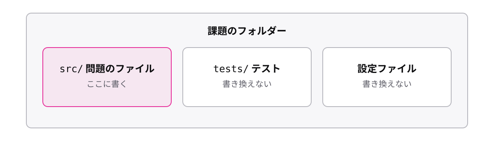
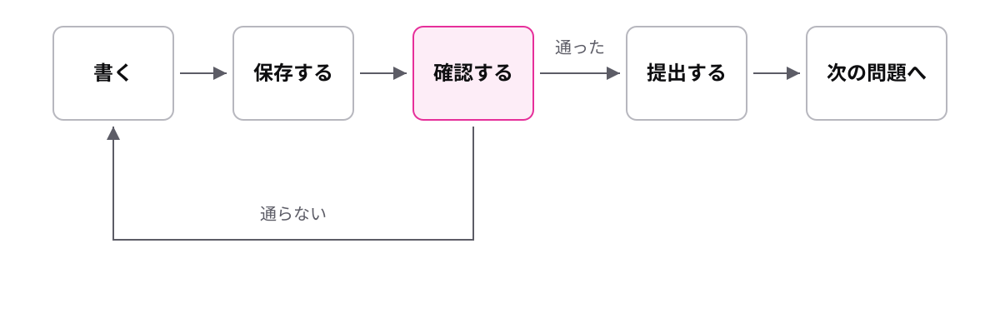
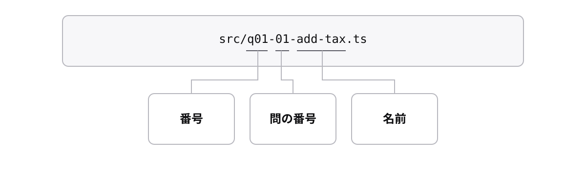
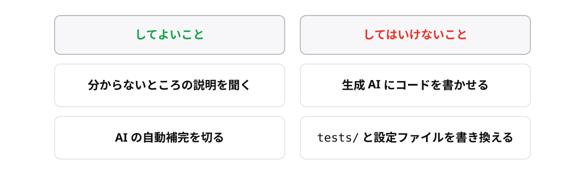

<!-- _class: lead -->
# 0-1-1 進め方とルール

<!-- ノート: 問題を進める順番と、守る決まりを確かめます。 -->

---

# どのファイルを直しますか？

問題のファイルと、テストのファイルが並んでいます。

<!-- ノート: 課題のフォルダーの中で、どれを開いて書くかを図で指します。テストは、期待した結果になるかを調べるものです。 -->

---

# 覚えること

一問ずつ自分で書き、確認が通ったら提出して次へ進みます。

<!-- ノート: 書く、保存する、確認する、提出する、の順に矢印をたどります。通らなければ結果を読んで書き直し、保存してもう一度確認します。 -->

---

# 一問につき、一つのファイル

通らなければ、結果を読んで直します。

<!-- ノート: ドリルは一問一ファイルで、q01 は番号、次の 01 は問の番号、add-tax は名前、末尾の .ts は TypeScript のファイルを表します。練習や応用には問の番号が付かないファイル名もあります。 -->

---

# 守るルール

通った理由も、自分の言葉で説明します。

<!-- ノート: 図の左右を指し、テストや設定を書き換えると提出できないことを伝えます。「説明すること」のすぐ下に、コメント（コードの中の説明文）を // に続けて書きます。 -->

---

<!-- _class: summary -->
# まとめ

一問ずつ自分で書き、確認が通ったら提出して次へ進みます。

<!-- ノート: 確認が通ったら、提出してから次の問題を開く順番を思い出してもらいます。 -->
