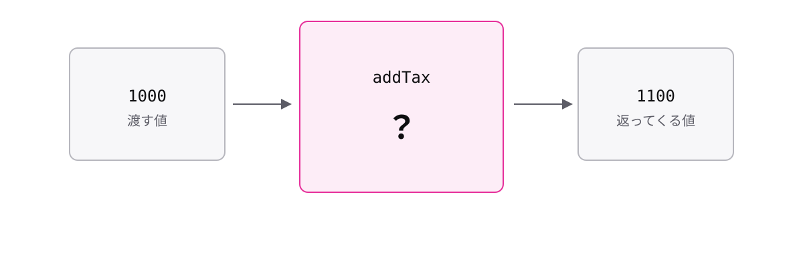
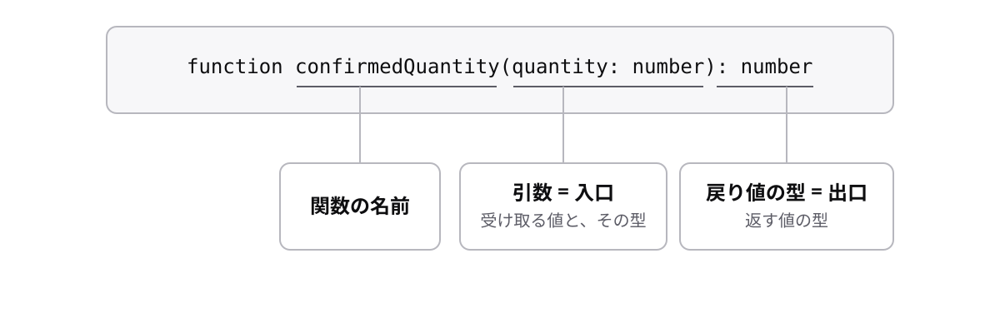
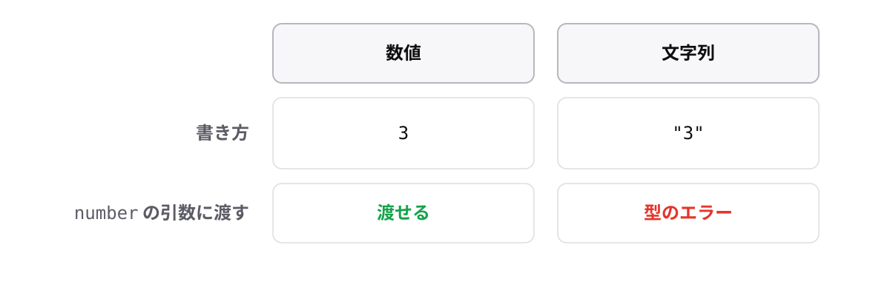

<!-- _class: lead -->
# 1-1-1 問題の読み方

<!-- ノート: 関数は、値を受け取り、処理して、値を返すまとまりです。問題でその中身を書く前に、どこを読むかを確かめます。 -->

---

# 箱の中に、何を書きますか？



テストは、渡す値と返ってくる値を決めています。

<!-- ノート: 問1のテストでは、addTax に 1000 を渡すと 1100、980 を渡すと 1078、5 を渡すと 5 が返ります。図の矢印で値の向きを示し、箱の中で何をするかは受講者に考えてもらいます。 -->

---

# 覚えること



関数の形とテストの値を読むと、中に書く処理の入口と出口が分かります。

<!-- ノート: function の後ろは関数の名前、quantity は受け取る値に付けた引数の名前です。型注釈は値の種類を表し、かっこの中の number は引数、かっこの後ろの number は戻り値が数値だと示します。 -->

---

# 書き方を読む

```ts
export function confirmedQuantity(quantity: number): number {
  // 受け取った数を、そのまま返す
  return quantity;
}
```

`confirmedQuantity(3)` の結果は `3` です。

<!-- ノート: export は別のファイルから使えるようにする印です。3 が quantity に入り、return がその値を返して関数を終えるところを順に指します。 -->

---

# よくある間違い



`3` と `"3"` は別の値です。

<!-- ノート: 引用符で囲んだ "3" は文字列で、number の引数に渡すと型のエラーになることを図で確かめます。 -->

---

<!-- _class: summary -->
# まとめ

関数の形とテストの値を読むと、中に書く処理の入口と出口が分かります。

<!-- ノート: 問題では関数の外側の名前や型を保ち、テストの値を手がかりに波かっこの中だけを書きます。 -->
