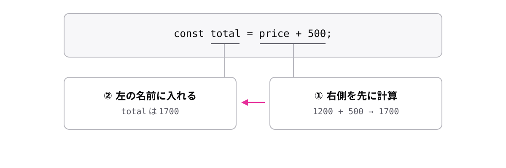
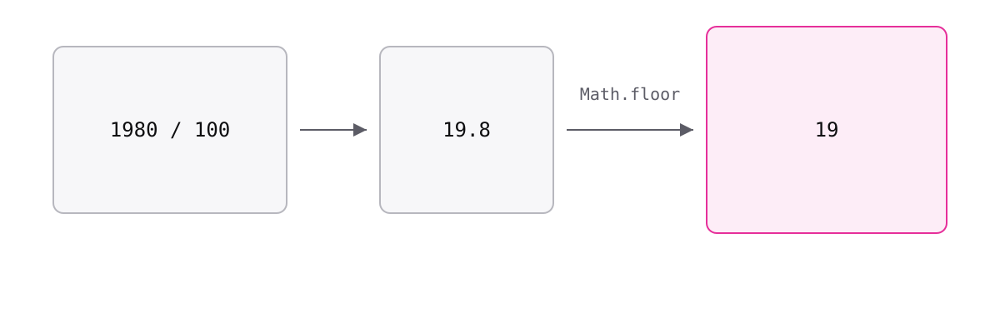

<!-- _class: lead -->
# 1-1-2 値に名前を付ける

<!-- ノート: 値に名前を付け、計算に使う書き方を見ます。動画は空のコード枠から文字と値の動きを見せます。 -->

---

# 税込でいくら？


1000 円の本に、10% の税がかかります。

<!-- ノート: 本の価格と税の割合を図の左から順に指します。税込の欄の「？」に入る金額を受講者に考えてもらいます。 -->

---

# 覚えること



const で値に名前を付けると、計算した結果も名前に入れて使えます。

<!-- ノート: 名前で値を使えるようにしたものを変数、値を名前に入れることを代入と呼びます。図の①から②を指し、右側を先に計算して結果を左の名前に入れる順番を示します。 -->

---

# 書き方を読む

```ts
const price = 1200;
const total = price + 500;
console.log(total);
// 結果: 1700
```

`=` は、右の値を左の名前に入れる印です。

<!-- ノート: 本の価格に送料を足した結果が total に入るところを、前の図と対応させます。const で作った名前には、あとから別の値を入れ直せません。 -->

---

# 小数点以下を切り捨てる



四捨五入ではないので、`20` にはなりません。

<!-- ノート: 100 円ごとのポイントを数える例として、19.8 を Math.floor に渡すと 19 になる流れを指します。問1では税込の金額を返し、1000 円は 1100 円、980 円は 1078 円、5 円は 5 円のままです。 -->

---

<!-- _class: summary -->
# まとめ

const で値に名前を付けると、計算した結果も名前に入れて使えます。

<!-- ノート: 計算結果を名前に入れておくと、その結果をあとで同じ名前で使えます。 -->
