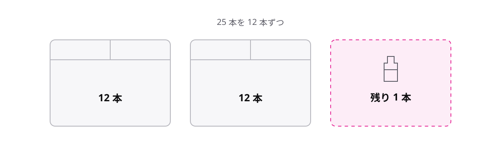
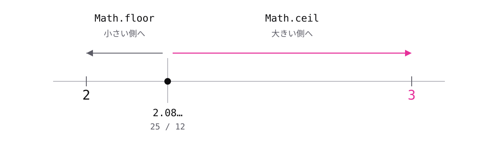
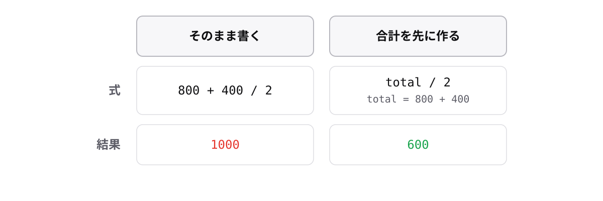

<!-- _class: lead -->
# 1-1-3 割り算と切り上げ

<!-- ノート: 商品を箱に詰める場面から、割り切れないときにどう数えるかを考えます。 -->

---

# 箱はいくつ必要？



25 本を、12 本入りの箱に詰めます。

<!-- ノート: 図の二つの箱と、箱に入っていない 1 本を順に指します。この 1 本も詰めるにはどうすればよいかを問いかけます。 -->

---

# 覚えること



割り算の結果を Math.ceil に渡すと、大きい側の整数へ切り上げられます。

<!-- ノート: 25 を 12 で割った値は 2 と 3 の間で、Math.floor は 2、Math.ceil は 3 に向かうことを矢印で示します。割った結果が整数なら、どちらもそのままです。 -->

---

# 書き方を読む

```ts
// 25 を 12 で割り、切り上げる
const boxes = Math.ceil(25 / 12);
console.log(boxes);
// 結果: 3
```

<!-- ノート: 割り算は / で書き、かっこの中の 25 / 12 を先に計算します。Math.ceil がその値を 3 に切り上げるので、残っていた 1 本も詰められます。 -->

---

# よくある間違い



800 円と 400 円の合計を、2 人で分けます。

割り算は、足し算より先に計算されます。

<!-- ノート: 送料込みの金額を 2 人で払う例として、左は 400 だけを半分にし、右は合計の 1200 を半分にすることを示します。問4では合計を先に作ってから割る練習をします。 -->

---

<!-- _class: summary -->
# まとめ

割り算の結果を Math.ceil に渡すと、大きい側の整数へ切り上げられます。

<!-- ノート: 端数があって箱がもう一つ必要な場面を思い出します。問2では、1 人分の金額を 100 円単位に切り上げる練習をします。 -->
