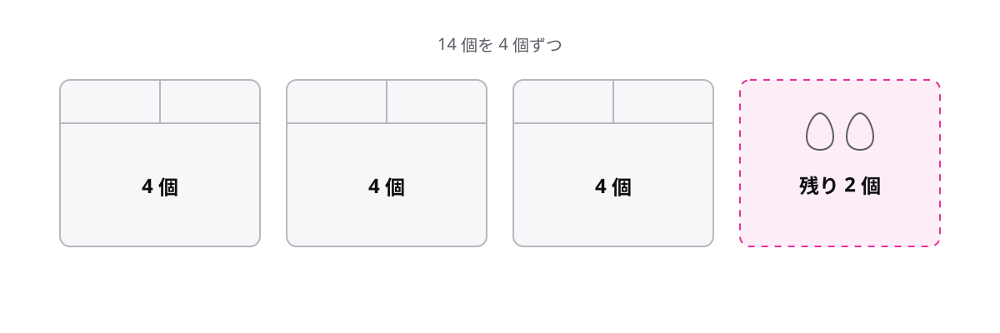
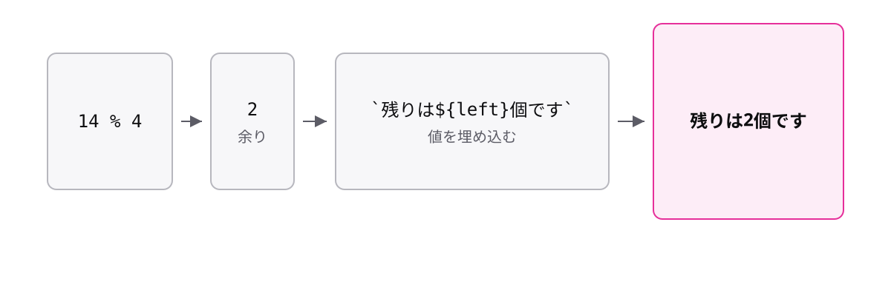
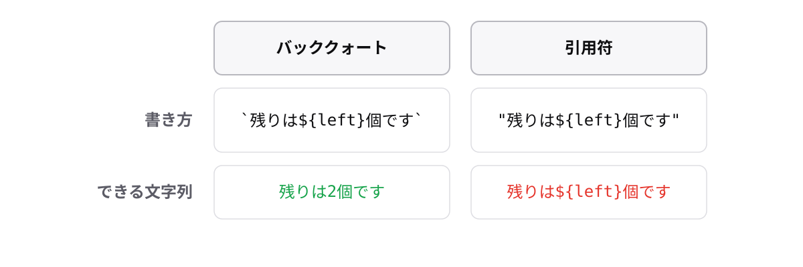

<!-- _class: lead -->
# 1-1-4 余りと文字の組み立て

<!-- ノート: 余りと文字の組み立てを、コードと値の動きで確かめます。 -->

---

# 残りを文で知らせるには？



14 個の卵を、4 個ずつパックに詰めます。

<!-- ノート: 4 個入りのパックを順に指し、パックに入らず残る 2 個に注目します。その数をどう文に入れるかを問いかけます。 -->

---

# 覚えること



余りを求め、テンプレートリテラルに値を埋め込むと、数を説明する文を作れます。

<!-- ノート: 0 以上の整数を正の整数で割ると、余りは 0 から割る数の手前までで、この図では 2 です。矢印をたどり、2 が文のどこに入るかを示します。 -->

---

# 書き方を読む

```ts
const left = 14 % 4;
const message = `残りは${left}個です`;
console.log(message);
// 結果: 残りは2個です
```

`%` は余り、`${ }` は埋め込む場所です。

<!-- ノート: バッククォートは日本語配列で Shift と @、英語配列で 1 の左のキーです。できた文は文字列で、型は string と書きます。 -->

---

# よくある間違い



引用符では、`${left}` も文字のままです。

文字列を `+` でつなぐと、lint のエラーになります。

<!-- ノート: 左右の書き方とできた文字列を見比べ、値が入る側を指します。lint は決まりを確かめる検査で、この課題では文字列のつなぎ方を検査します。 -->

---

<!-- _class: summary -->
# まとめ

余りを求め、テンプレートリテラルに値を埋め込むと、数を説明する文を作れます。

<!-- ノート: 問3では、時間と残りの分を文字列にします。余りを求めてから文に入れる順番を思い出してもらいます。 -->
