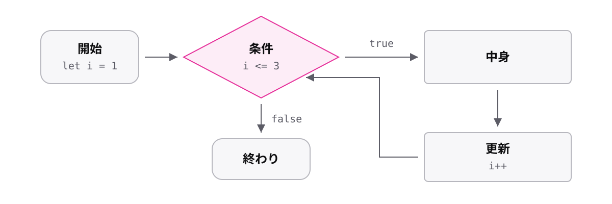
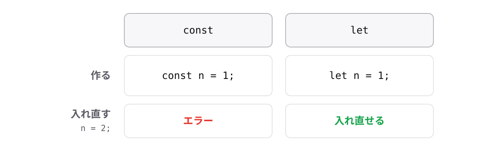

<!-- _class: lead -->
# 1-2-1 入れ直す変数とくり返し

<!-- ノート: 毎月の積立を例に、同じ変数の値がどう変わるかを見ます。 -->

---

# 毎月、どう増やしますか？


毎月 5000 円ずつ、同じ金額に足していきます。

<!-- ノート: 左から順に金額を指し、毎月、前の月の金額に 5000 円を足すことを確かめます。 -->

---

# 覚えること



入れ直す変数を let で作り、for でくり返すと、値を少しずつ変えられます。

<!-- ノート: for は開始、条件、中身、更新、条件の順に進むので、図の矢印を一周たどります。条件が成り立つ結果は true、成り立たない結果は false です。 -->

---

# 値を追ってみる

```ts
let saving = 0;
for (let i = 1; i <= 3; i++) {
  saving += 5000;
}
// 結果: saving は 15000
```

`saving` は 5000、10000、15000 と増えます。

<!-- ノート: 「以下」の <= は同じ数も含み、++ は 1 増やす書き方です。+= は足して入れ直し、*= は掛けて入れ直します。 -->

---

# よくある間違い



入れ直す変数は `let` で作ります。

値を入れ直すことを、再代入と呼びます。

<!-- ノート: 図の下の行を指し、const で作った変数に値を入れ直すとエラーになることを確かめます。値を入れ直すときは、もう一度 let を書く必要はありません。 -->

---

<!-- _class: summary -->
# まとめ

入れ直す変数を let で作り、for でくり返すと、値を少しずつ変えられます。

<!-- ノート: 問5では順に足し、問6では順に掛けます。問題の関数の形とテストで確かめる値を読み、自分で中身を書きます。 -->
