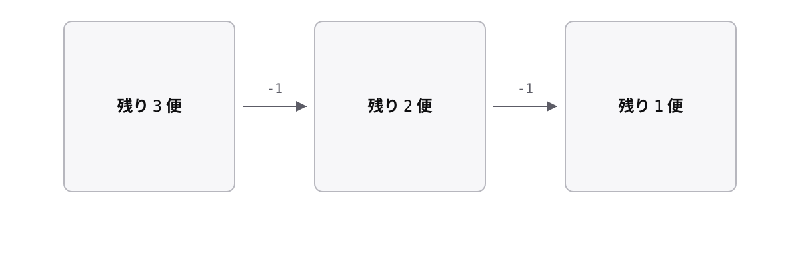
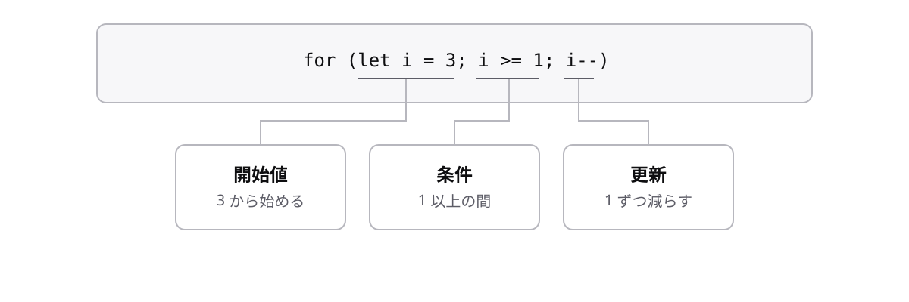
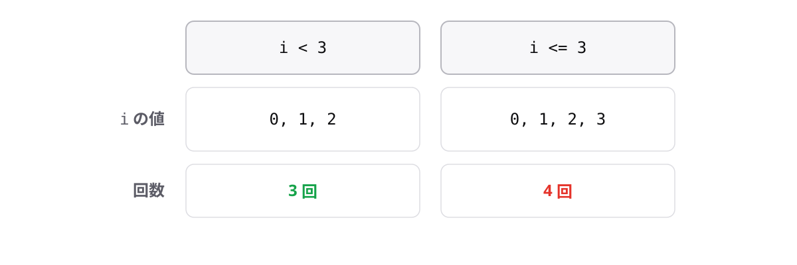

<!-- _class: lead -->
# 1-2-2 数え方を変える

<!-- ノート: 数を減らす場面と、決めた回数だけくり返す場面を見ます。 -->

---

# 3、2、1 と減らすには？



残りの発送便は、3、2、1 と減ります。

<!-- ノート: 発送便の残りの数を左から順に指し、次の数は前の数より 1 小さいことを確かめます。 -->

---

# 覚えること



for の開始値・条件・更新をそろえると、逆向きや指定回数のくり返しを書けます。

<!-- ノート: コードの三つの部分を下の箱と対応させます。>= は同じ数も含む「以上」、-- は 1 減らす書き方です。 -->

---

# 値を追ってみる

```ts
for (let i = 3; i >= 1; i--) {
  console.log(i);
}
// 結果: 3、2、1 の順に表示
```

`i` が 0 になると、条件に合わず終わります。

<!-- ノート: 発送便の例を番号だけで確かめ、1 も表示することを示します。次の 0 では 0 >= 1 が false になるので、中身に進みません。 -->

---

# よくある間違い



0 から始めて 3 回なら、`i < 3` と書きます。

<!-- ノート: 「未満」の < は同じ数を含まず、0 から数えるときに i <= n と書くと 1 回多くなります。0 < 0 のように最初から条件に合わなければ、中身は 1 回も実行しません。 -->

---

<!-- _class: summary -->
# まとめ

for の開始値・条件・更新をそろえると、逆向きや指定回数のくり返しを書けます。

<!-- ノート: 問7では数を減らし、問8では指定の回数だけ掛けます。問題の関数の形とテストで確かめる値を読み、自分で中身を書きます。 -->
