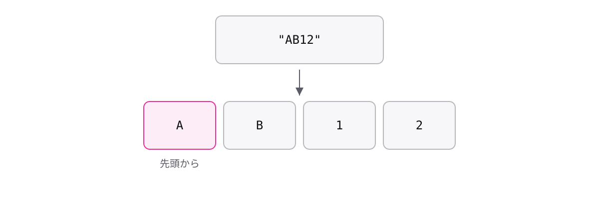
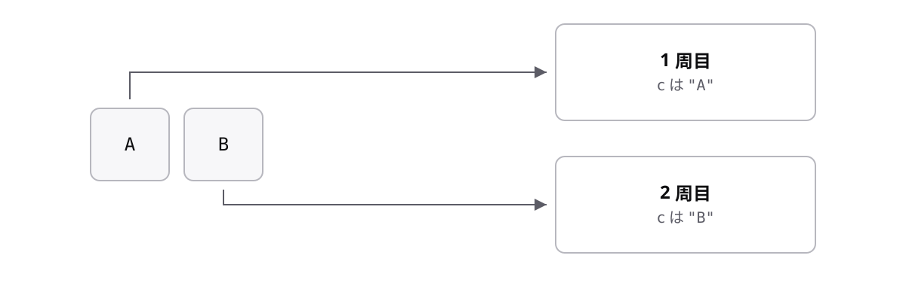
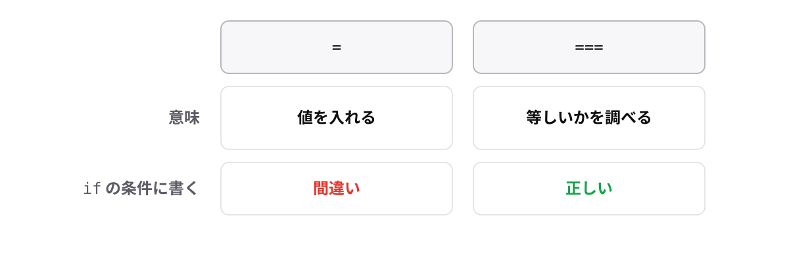

<!-- _class: lead -->
# 1-2-3 1 文字ずつ見る

<!-- ノート: 注文番号を一文字ずつ見て、取り出した文字を使う場面を考えます。 -->

---

# 1 文字ずつ取り出すには？



注文番号を、先頭から 1 文字ずつ見ます。

<!-- ノート: 上の注文番号を示し、下のマスを A から順に指します。文字ごとに区切りを付けるには、まず一文字ずつ取り出します。 -->

---

# 覚えること



for-of で文字を取り出し、条件を調べたり、つなぐ順を変えたりできます。

<!-- ノート: 図の矢印をたどり、c は 1 周ごとに新しく作るので const で書けると伝えます。空の文字列では、一度もくり返しません。 -->

---

# 値を追ってみる

```ts
for (const c of "AB") {
  console.log(c);
}
// 結果: A、B の順に表示
```

`c` には、1 周ごとに次の文字が入ります。

<!-- ノート: 先に A、次に B が表示されることを確かめます。文字がなくなると、くり返しは終わります。 -->

---

# よくある間違い



比べるときは、`===` を書きます。

`.includes()` は、含むかを調べます。

<!-- ノート: if は条件に合うときだけ中身を実行し、図の = は値を入れ、=== は等しいかを調べます。値の後ろに点を付けて呼ぶ関数をメソッドと呼び、.includes() はその一つです。 -->

---

<!-- _class: summary -->
# まとめ

for-of で文字を取り出し、条件を調べたり、つなぐ順を変えたりできます。

<!-- ノート: 文字列の連結では + が左から順につなぐので、問10のように前に足す文字は左に置きます。問9では等しいか、問16では含むかを調べ、関数の形とテストの値を読んで自分で中身を書きます。 -->
