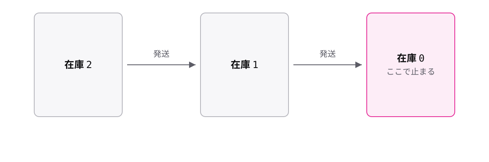
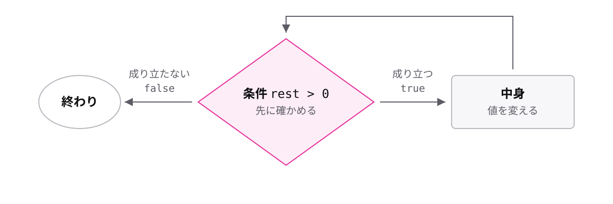
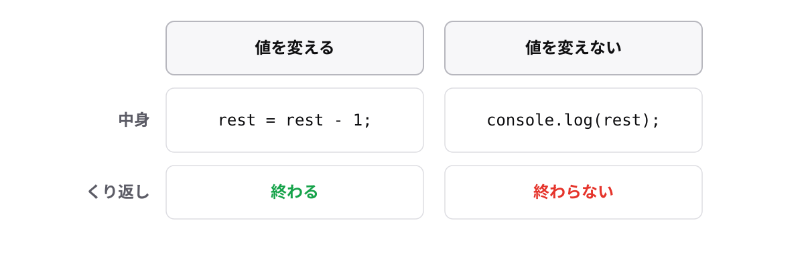

<!-- _class: lead -->
# 1-3-1 回数の決まらないくり返し

<!-- ノート: 在庫の残りを見ながら、いつ発送を続け、いつ止めるかを考えます。 -->

---

# なくなるまで、くり返すには？



在庫がなくなるまで、発送をくり返します。

<!-- ノート: 発送の矢印を指し、在庫が 2、1、0 と減るのを追います。0 になったら次の発送はありません。 -->

---

# 覚えること



while は条件を先に確かめ、true の間だけ値を変えながらくり返します。

<!-- ノート: > は「より大きい」で、1 > 0 は true、0 > 0 は false です。中身を実行するたびに条件へ戻り、最初から false なら中身を一度も実行しません。 -->

---

# 書き方を読む

```ts
let rest = 2;
while (rest > 0) {
  rest = rest - 1;
}
// 結果: rest は 0
```

`rest > 0` が `false` になると終わります。

<!-- ノート: rest が 2 のときと 1 のときは中身で 1 ずつ減り、0 では条件を確かめたところで止まります。引数は let の変数に写してから中身で値を変えます。 -->

---

# よくある間違い



中身で値を変えないと、くり返しが終わりません。

<!-- ノート: 右側では rest を何度表示しても、初めの 2 のままです。課題では引数への再代入は lint でエラーになります。 -->

---

<!-- _class: summary -->
# まとめ

while は条件を先に確かめ、true の間だけ値を変えながらくり返します。

<!-- ノート: !== は等しくないかを比べる記号で、=== の反対です。問11・17・18では、最初の値、続ける条件、中で変える値を分けて考えます。 -->
