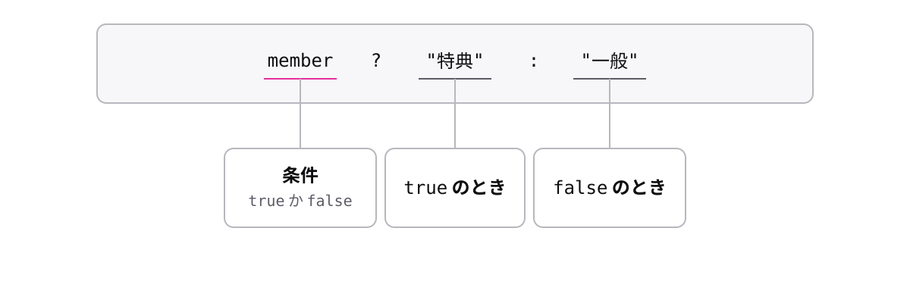
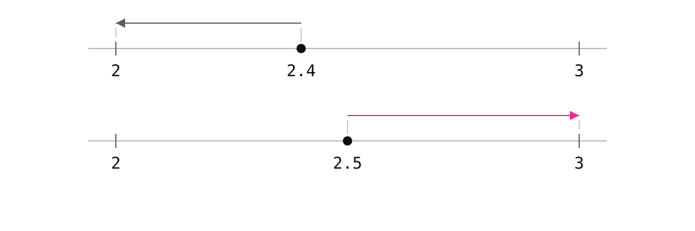

<!-- _class: lead -->
# 1-3-2 条件で選ぶ

<!-- ノート: 条件に合わせて表示を選ぶ方法と、返す値を文字列や四捨五入した数にする方法を扱います。 -->

---

# 相手によって、表示を変えるには？


会員かどうかで、表示を変えます。

<!-- ノート: 会員と会員以外で、どちらの表示へ進むかを図でたどります。boolean は真を表す true と偽を表す false だけの型です。 -->

---

# 覚えること



条件で値を選び、文字列への変換や四捨五入をして返せます。

<!-- ノート: 条件演算子は、条件が真なら ? のあとの A、偽なら : のあとの B を選びます。下線とラベルをたどり、選んだほうが全体の値になることを示します。 -->

---

# 書き方を読む

```ts
function label(member: boolean): string {
  return member ? "特典" : "一般";
}
// 結果: label(true) は「特典」
```

`条件 ? A : B` は、true なら A を選びます。

<!-- ノート: true を渡すと「特典」を返し、false を渡すと「一般」を返します。|| は「または」で、つないだ条件のどちらかが true なら全体が true になります。 -->

---

# 四捨五入の境目



`Math.round(2.4)` は 2、`Math.round(2.5)` は 3 です。

数値を文字列にするには、`String()` を使います。

<!-- ノート: 正の数で確かめ、小数部分が 0.5 未満なら小さい整数、0.5 以上なら大きい整数になることを示します。文字列を返す関数では、受付番号のような数値を String で変換して返します。 -->

---

<!-- _class: summary -->
# まとめ

条件で値を選び、文字列への変換や四捨五入をして返せます。

<!-- ノート: 問12・14・15では条件をどう分けるかを考え、問13では計算してから最後に一度だけ四捨五入します。 -->
