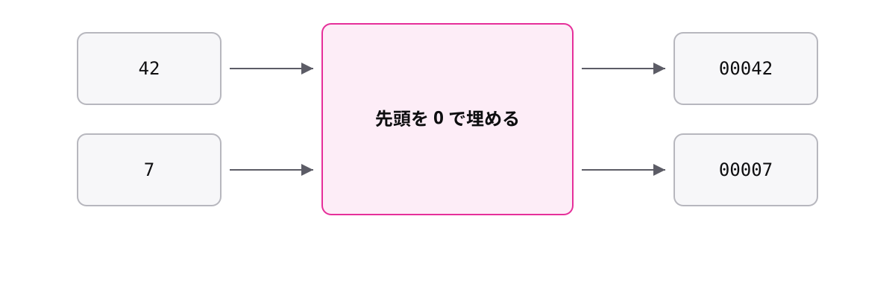
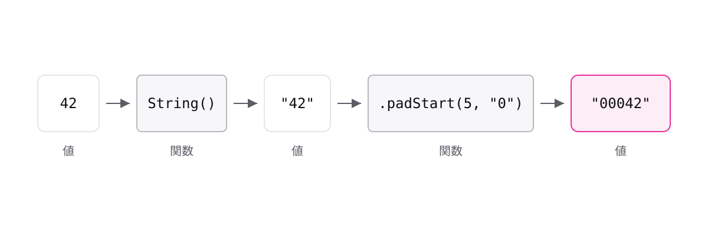
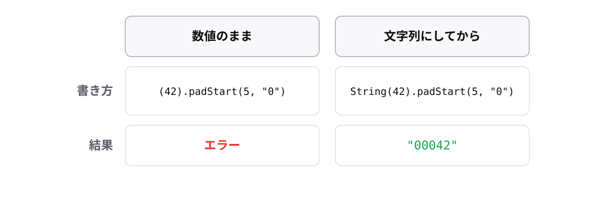

<!-- _class: lead -->
# 1-3-3 関数を分けて使う

<!-- ノート: 小さな関数を作って名前を付け、値を渡して呼ぶところまで確かめます。 -->

---

# 同じ処理を、何度も使うには？



注文番号の先頭を、0 で埋めてそろえます。

<!-- ノート: 42 と 7 を別々に図の左からたどります。同じ処理を通ると、どちらも 5 文字の注文番号になります。 -->

---

# 覚えること



小さな関数に名前を付けて呼ぶと、計算や整形を順番に組み立てられます。

<!-- ノート: String() で数値を文字列に変え、.padStart(5, "0") の 5 で長さ、"0" で埋める文字を指定します。- は引き算で、3000 - 1200 の結果の 1800 も次の関数に渡せます。 -->

---

# 書き方を読む

```ts
const toYen = (price: number) => `${price}円`;
const label = toYen(500);
console.log(label);
// 結果: 500円
```

`toYen` という名前で、何度でも呼べます。

<!-- ノート: アロー関数は関数の短い書き方で、=> の左で引数を受け取り、右が式一つなら波かっこと return を省けます。=> は関数を作る印で、>= は「以上」を比べる印です。 -->

---

# よくある間違い



`.padStart()` は、文字列にだけ使えます。

<!-- ノート: 左右を見比べ、右側で String(42) を先に使うと、"00042" になることを確かめます。.padStart() は足りない分を先頭に足すので、すでに長い文字列はそのままです。 -->

---

<!-- _class: summary -->
# まとめ

小さな関数に名前を付けて呼ぶと、計算や整形を順番に組み立てられます。

<!-- ノート: 問19では二つの元の数から次の数を作ってから更新します。問20では時・分・秒を計算し、それぞれを同じ形で整えます。 -->
