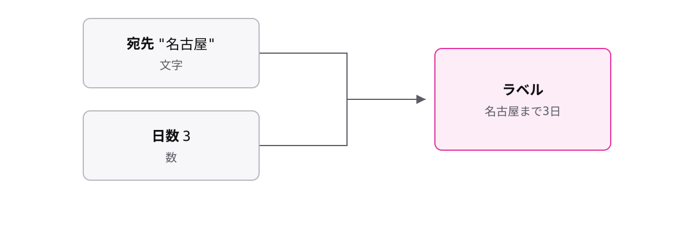
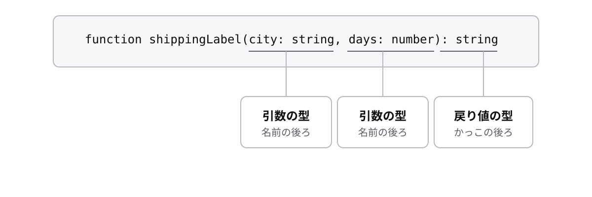
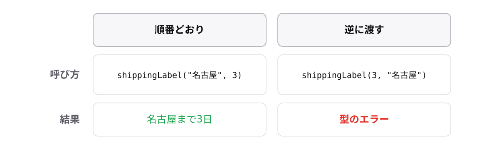

<!-- _class: lead -->
# 2-1-1 型注釈を自分で書く

<!-- ノート: 型は値の種類で、型注釈はその種類をコードに書く印です。配送ラベルの例で、値を受け取るところと返すところを見ます。 -->

---

# ラベルに、何を渡しますか？



宛先は文字で、日数は数です。

<!-- ノート: 左の二つの箱を指し、宛先と日数を順に読みます。右のラベルにどちらの値も入ることを確かめます。 -->

---

# 覚えること



引数は名前の後ろ、戻り値はかっこの後ろに型を書きます。

<!-- ノート: 引数は `名前: 型` と書いてカンマで区切り、戻り値の型は閉じかっこの後ろに `: 型` と書きます。string は文字列、number は数値です。 -->

---

# 書き方を読む

```ts
function shippingLabel(city: string, days: number): string {
  return `${city}まで${days}日`;
}
// 結果: shippingLabel("名古屋", 3) は「名古屋まで3日」
```

かっこの中は引数、後ろは戻り値です。

<!-- ノート: 名古屋が city に、3 が days に入り、テンプレートリテラルの `${ }` に値が入ります。return はできた文字列を返します。 -->

---

# よくある間違い



型が合わないと、実行する前にエラーが見つかります。

<!-- ノート: 文字列と数値を逆に渡すと実行前にエラーが見つかります。引数は型と順番に加えて、数も例とそろえます。 -->

---

<!-- _class: summary -->
# まとめ

引数は名前の後ろ、戻り値はかっこの後ろに型を書きます。

<!-- ノート: 問1〜3では、問題のテスト値から引数と戻り値の型を確かめます。答えの処理は自分で書きます。 -->
