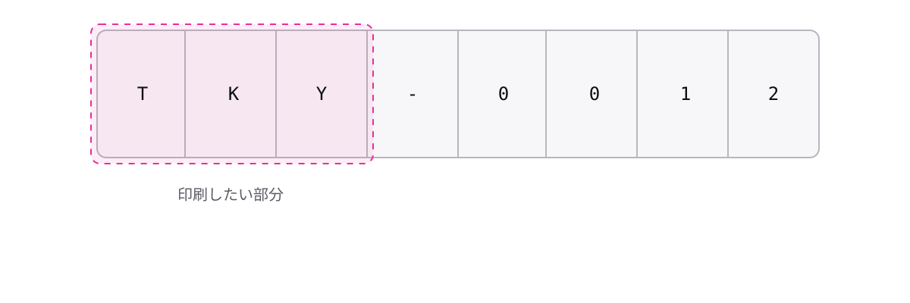
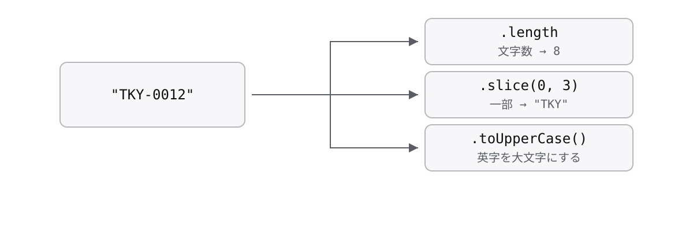
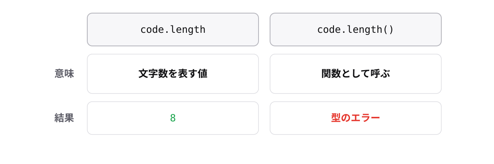

<!-- _class: lead -->
# 2-1-2 文字列の道具

<!-- ノート: 商品コードを例に、文字数を調べたり、一部を取り出したりします。 -->

---

# 必要な部分だけ、取り出すには？



商品コードから、先頭の 3 文字だけ印刷します。

<!-- ノート: 左から 3 文字を指し、ハイフンの手前までが印刷する部分だと確かめます。 -->

---

# 覚えること



文字列の長さや一部を調べ、加工や条件の組合せに使えます。

<!-- ノート: 上から文字数、一部、大文字にした結果を指します。toUpperCase は英字を大文字にするので、図の値はそのままで、まとめの例の abc-12 は ABC-12 になります。 -->

---

# 書き方を読む

```ts
const code = "TKY-0012";
const area = code.slice(0, 3);
console.log(area);
// 結果: TKY
```

位置 0 から、3 の手前までを取り出します。

<!-- ノート: slice のかっこに始めと終わりを渡し、0・1・2 番目を取り出して area に入れます。終わりの 3 番目にあるハイフンは入りません。 -->

---

# よくある間違い



`length` には、かっこを付けません。

<!-- ノート: length は文字数を表す値なので、かっこを付けて関数として呼ぶと型のエラーになります。repeat は指定した回数だけ文字列をつなげ、toLocaleString は地域に応じた表示を作ります。 -->

---

<!-- _class: summary -->
# まとめ

文字列の長さや一部を調べ、加工や条件の組合せに使えます。

<!-- ノート: && は「かつ」で、両方の条件が true のときだけ true になります。問題ではテスト値を確かめ、答えの処理は自分で書きます。 -->
