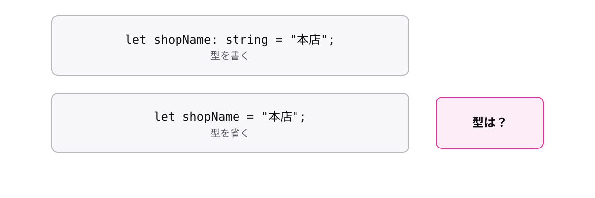
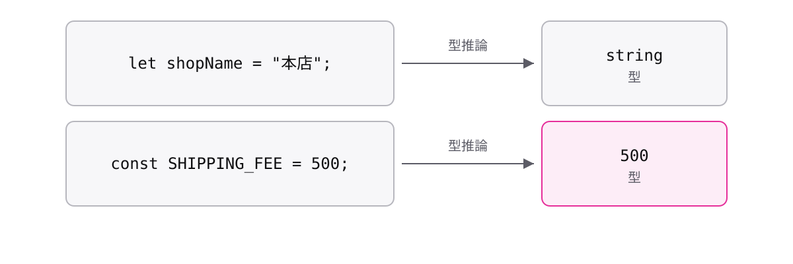
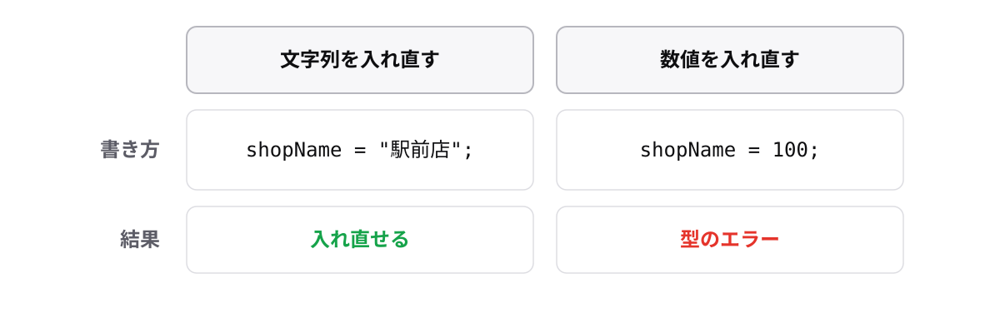

<!-- _class: lead -->
# 3-1-1 型が自動で決まる

<!-- ノート: 店名と送料の例で、値から型がどのように決まるかを確かめます。 -->

---

# 型を書かないと、どうなる？



型を書くところを、省いてみます。

<!-- ノート: 上下の帯を見比べ、下の帯で省いた部分を指します。型を書かないと何が起きるかを問いかけます。 -->

---

# 覚えること



値や return から型が決まり、戻り値の型注釈を省けます。

<!-- ノート: 入れ直せる let の店名は string です。const の送料は 500 そのものが型になり、値そのものを表す型をリテラル型と呼びます。 -->

---

# 書き方を読む

```ts
export const SHIPPING_FEE = 500;
let shopName = "本店";
// 結果: SHIPPING_FEE の型は 500、shopName の型は string
```

値を見て型を決めることを、型推論と呼びます。

<!-- ノート: export const は、別のファイルから使える定数を作ります。関数では、return で返す値から戻り値の型が決まります。 -->

---

# よくある間違い



型注釈を省いても、型は決まっています。

<!-- ノート: 文字列の駅前店は入れ直せますが、数値の 100 は型のエラーになります。複数の候補は「どちらか」を表す縦棒でまとめ、この型をユニオン型と呼びます。 -->

---

<!-- _class: summary -->
# まとめ

値や return から型が決まり、戻り値の型注釈を省けます。

<!-- ノート: undefined は値がないことを表します。問題では、テスト値から返す値とその型を確かめ、答えの処理は自分で書きます。 -->
