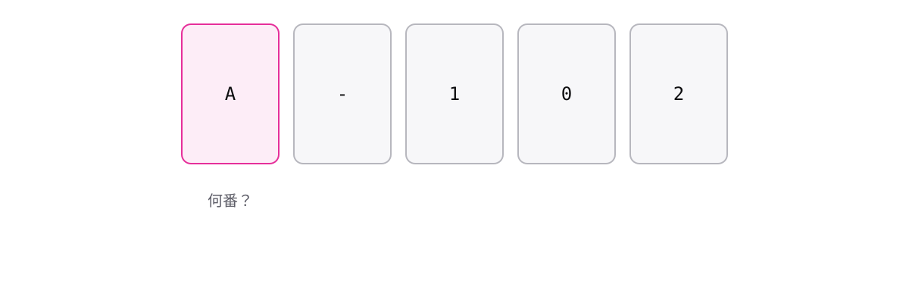
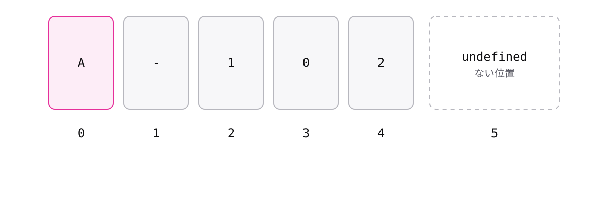
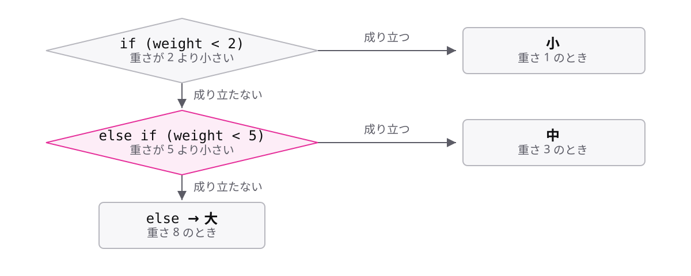

<!-- _class: lead -->
# 3-1-2 添字と else if

<!-- ノート: 注文番号の文字の位置と、配送サイズを決める条件の順番を確かめます。 -->

---

# 先頭の文字は、何番ですか？



注文番号の先頭だけを、伝票に載せます。

<!-- ノート: 先頭の A を指し、この文字を取り出すために何番と指定すればよいかを問いかけます。 -->

---

# 覚えること



文字の位置と条件の順番を確かめ、数は桁数を決めて表示できます。

<!-- ノート: 添字は文字の位置を表す番号で、左端から 0、1、2 と数えます。5 には文字がなく、値がないことを表す undefined になります。 -->

---

# 書き方を読む

```ts
const orderId = "A-102";
const head = orderId[0];
console.log(head);
// 結果: A
```

先頭は `[1]` ではなく `[0]` です。

<!-- ノート: 角かっこで位置を指定し、[0] で先頭の A を取り出して head に入れます。[1] は二つ目のハイフンです。 -->

---

# 条件は、上から順に確かめる



`else if` は、前の条件に合わないときだけ確かめます。

`toFixed` は、桁数を決めた文字列を作ります。

<!-- ノート: 重さ 1 は最初の条件で小、3 は次の条件で中、8 はどちらにも合わず、まとめのコードで最初に入れた大のままです。toFixed は小数点以下の桁数をそろえ、25 に 1 桁を指定すると文字列の「25.0」になります。 -->

---

<!-- _class: summary -->
# まとめ

文字の位置と条件の順番を確かめ、数は桁数を決めて表示できます。

<!-- ノート: 問20では、先頭の文字がある場合と、空の文字列の場合をテスト値で確かめます。答えの処理は自分で書きます。 -->
