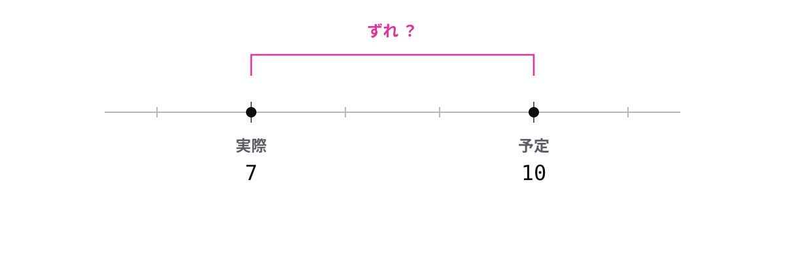
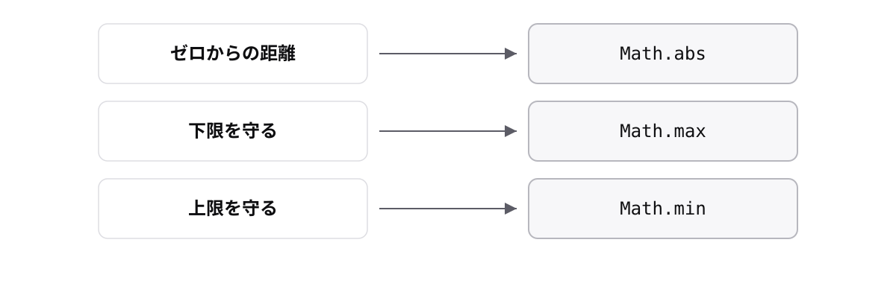
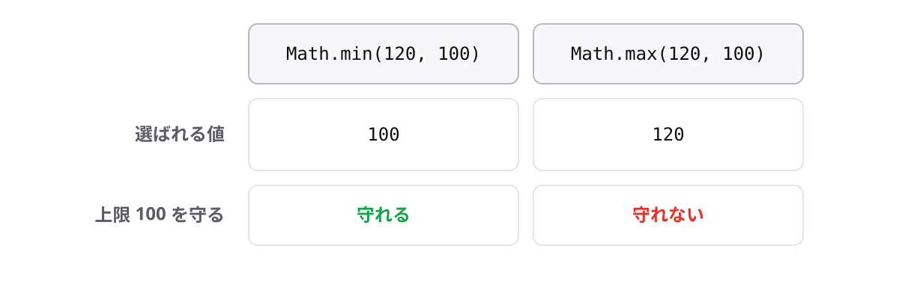

<!-- _class: lead -->
# 4-1-1 計算の道具

<!-- ノート: 在庫のずれを例に、数の計算に使う道具を見ます。 -->

---

# ずれの大きさを、どう伝えますか？



予定より在庫が少ないとき、ずれを伝えます。

<!-- ノート: 数直線で実際の 7 と予定の 10 を指し、その間の幅に注目してもらいます。 -->

---

# 覚えること



型注釈で数の入口と出口を決め、目的に合う計算の道具を選べます。

<!-- ノート: 引数と戻り値の型は number で、Math.abs はゼロからの距離を返し、Math.max は下限、Math.min は上限を守るのに使います。** は同じ数を繰り返し掛ける累乗、Math.sqrt は平方根、Math.hypot は棚などの斜めの長さを求める道具です。 -->

---

# 書き方を読む

```ts
const gap = Math.abs(-3);
console.log(gap);
// 結果: 3
```

絶対値は、ゼロからの距離です。

<!-- ノート: 予定より 3 個少ないときの差 -3 を Math.abs に渡すと、ずれの大きさは 3 になります。 -->

---

# よくある間違い



上限には `Math.min`、下限には `Math.max` を使います。

<!-- ノート: 左右で選ばれた数を見比べ、上限の 100 以下に収まるのは左だけだと確かめます。 -->

---

<!-- _class: summary -->
# まとめ

型注釈で数の入口と出口を決め、目的に合う計算の道具を選べます。

<!-- ノート: 問題では引数と戻り値の型注釈とテストの値を先に確かめ、中の処理を自分で書きます。 -->
