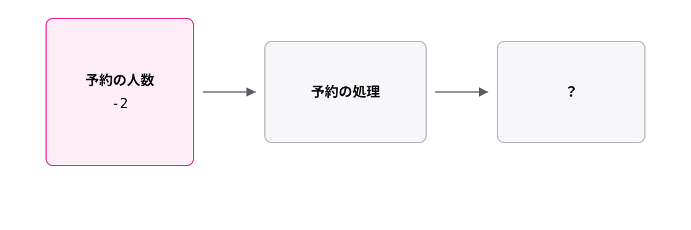
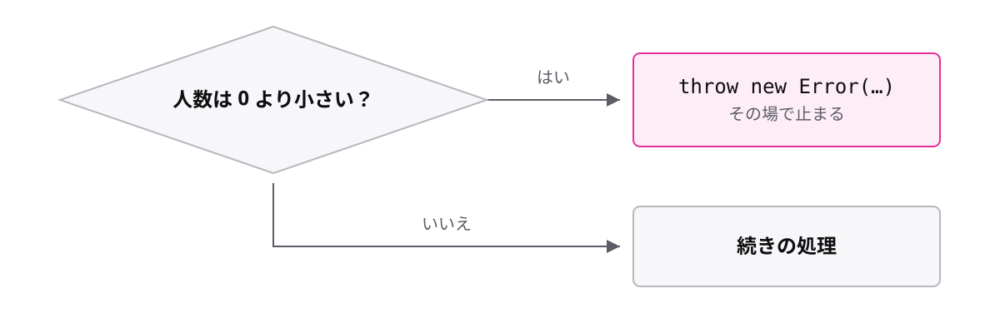
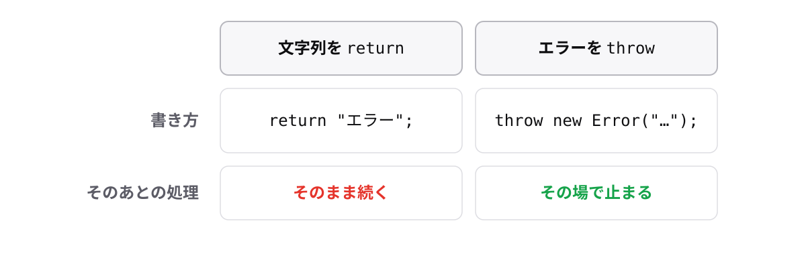

<!-- _class: lead -->
# 4-1-2 エラーを投げる

<!-- ノート: 予約の人数を例に、受け付けない値が届いたときの処理を見ます。 -->

---

# そのまま続けて、よいですか？



予約の人数に、マイナスの数が届きました。

<!-- ノート: 左の -2 から矢印をたどり、予約の処理を続けてよいかを受講者に問いかけます。 -->

---

# 覚えること



受け付けない値は throw new Error で止め、! で条件を反対にできます。

<!-- ノート: 人数が 0 より小さいとき、new Error がメッセージ付きのエラーを作り、throw がそれを投げてその場で処理を止めます。0 以上なら、続きの処理へ進みます。 -->

---

# 書き方を読む

```ts
function checkGuests(guests: number): number {
  if (guests < 0) throw new Error("人数は 0 以上にしてください");
  return guests;
}
console.log(checkGuests(3)); // 結果: 3
```

`!true` は `false`、`!false` は `true` です。

<!-- ノート: 3 は条件に当てはまらずそのまま返り、-1 を渡すとエラーを投げて return には進みません。感嘆符 ! は真偽値を反対にする記号で、支払済みの反対を未払いとして表せます。 -->

---

# よくある間違い



文字列を返すと、呼び出した側は処理を続けます。

<!-- ノート: return は関数を終えて呼び出した側へ値を返し、number を返す型注釈があれば文字列は型のエラーになります。右の throw ではエラーを投げた時点で止まり、普通の戻り値は返りません。 -->

---

<!-- _class: summary -->
# まとめ

受け付けない値は throw new Error で止め、! で条件を反対にできます。

<!-- ノート: 問題では型注釈とテストの値を先に確かめ、どの値が届いたときに止めるかを考えます。 -->
