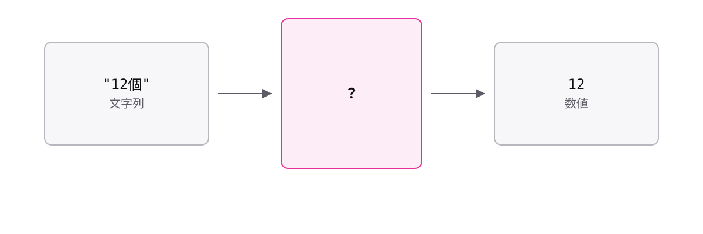
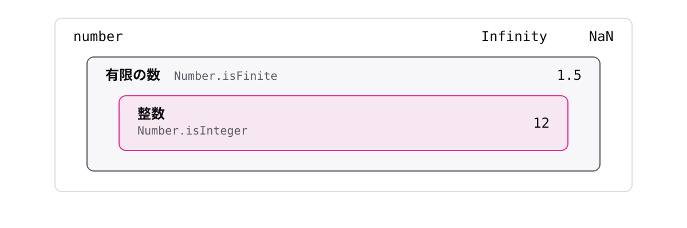
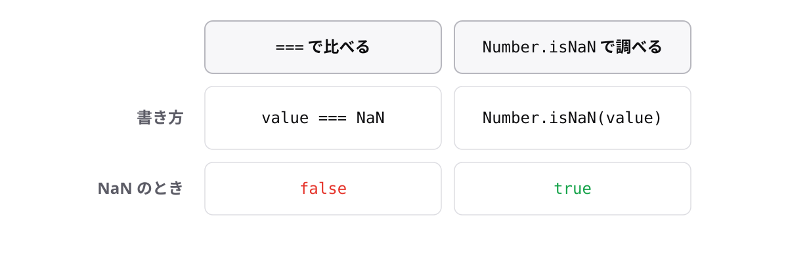

<!-- _class: lead -->
# 4-1-3 文字列から数を取り出す

<!-- ノート: 注文数の文字列を例に、計算に使う数の取り出し方を見ます。 -->

---

# 文字列から、数を取り出すには？



「12個」から、計算に使う数を取り出します。

<!-- ノート: 左の文字列と右の数値を順に指し、文字の付いた注文数をどう計算に使える形にするかを問いかけます。 -->

---

# 覚えること



文字列から整数を取り出し、NaN・有限の数・整数を区別できます。

<!-- ノート: number の中で、NaN は数にできなかったことを表し、Infinity は有限でない数です。Number.isNaN は NaN、Number.isFinite は有限の数、Number.isInteger は整数かを調べます。 -->

---

# 書き方を読む

```ts
const quantity = Number.parseInt("12個", 10);
console.log(quantity);
// 結果: 12
```

先頭から整数を読めないと、`NaN` になります。

<!-- ノート: Number.parseInt は先頭から整数を読み、「個」の手前で止まり、先頭の空白や符号は読めます。二つ目の 10 は十進数で読む指定で、「約3」のように先頭から整数を読めないと NaN になります。 -->

---

# よくある間違い



`NaN` は、`===` では見つけられません。

<!-- ノート: NaN は自分自身と === で比べても false になります。右の Number.isNaN は NaN のときだけ true を返します。 -->

---

<!-- _class: summary -->
# まとめ

文字列から整数を取り出し、NaN・有限の数・整数を区別できます。

<!-- ノート: 問題では型注釈とテストの値を先に確かめ、数を読めない場合にどうするかも考えます。 -->
