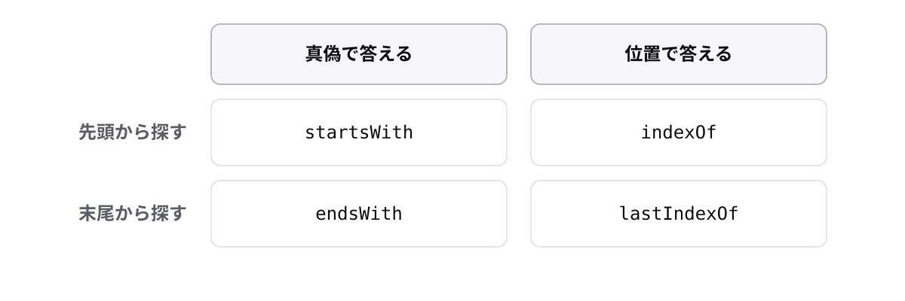
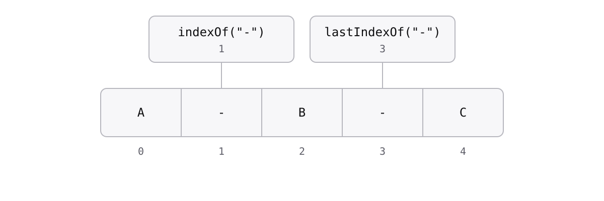

<!-- _class: lead -->
# 5-1-1 文字列を探す

<!-- ノート: 注文番号を例に、探す場所と、答えとして何が欲しいかを考えます。 -->

---

# 決まりに合うか、調べるには？


注文番号の先頭と末尾を調べます。

<!-- ノート: 下線をたどり、先頭の ORD- と末尾の -JP をそれぞれ指します。 -->

---

# 覚えること



探したい場所と、真偽か位置かに合わせて書き方を選びます。

<!-- ノート: 左の列は先頭や末尾が一致するかを true か false で返し、boolean はその真偽を表す型です。右の列は最初の一致と最後の一致の位置を返します。 -->

---

# 書き方を読む

```ts
const order = "ORD-42-JP";
console.log(order.startsWith("ORD-"));
// 結果: true
```

末尾なら `.endsWith("-JP")` を使います。

<!-- ノート: メソッドは、値に対する操作の名前です。注文番号が ORD- で始まるので、結果は true になります。 -->

---

# 0 は、見つかった位置です



`indexOf("A")` は `0` です。先頭で見つかりました。

見つからないときは `-1` です。

<!-- ノート: 最初のハイフンは位置 1、最後のハイフンは位置 3 にあり、# を探すと -1 です。0 を見つからない印と考えるのはよくある間違いです。 -->

---

<!-- _class: summary -->
# まとめ

探したい場所と、真偽か位置かに合わせて書き方を選びます。

<!-- ノート: 問6・問7・問11・問16では、一致するかを知りたいのか、見つかった位置を知りたいのかを確かめます。 -->
