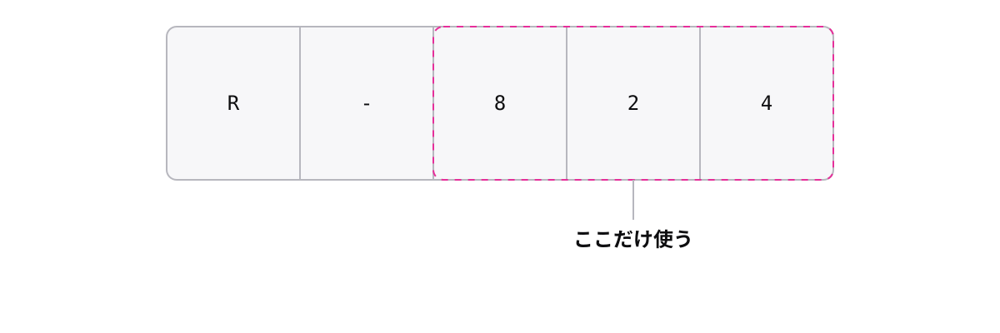
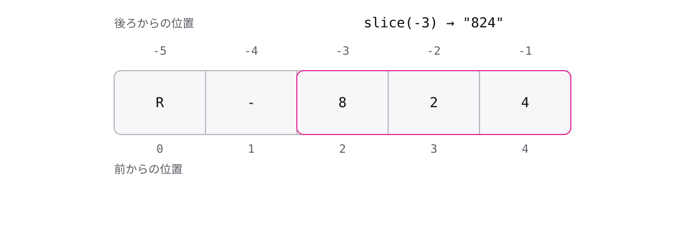
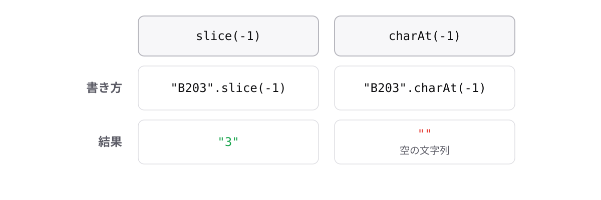

<!-- _class: lead -->
# 5-1-2 位置で取り出す

<!-- ノート: 予約番号を例に、位置を手がかりにして文字を取り出します。 -->

---

# 後ろの 3 文字だけ、取り出すには？



予約番号の、後ろの 3 文字を使います。

<!-- ノート: 予約番号を一文字ずつ指し、点線の枠で囲んだ後ろの三文字に注目します。 -->

---

# 覚えること



後ろから取り出すなら slice の負の位置、指定の一文字なら charAt を使います。

<!-- ノート: 下の数字は先頭の 0 から、上の数字は末尾の -1 から数えた位置です。-3 のマスから末尾までを枠で示します。 -->

---

# 書き方を読む

```ts
const ticket = "R-824";
console.log(ticket.slice(-3));
// 結果: "824"
```

後ろから 3 文字目から、末尾までを取り出します。

<!-- ノート: 終わりの位置を省くと末尾まで取り出します。slice(0, 2) なら終わりの位置 2 の 8 は含めず、R- を返します。 -->

---

# よくある間違い



`charAt` は、ない位置では空の文字列を返します。

<!-- ノート: 空の文字列は文字が一つもない値で、"B203".charAt(9) と "B203".charAt(-1) はどちらも "" を返します。"B203".charAt(0) は先頭の "B" を返します。 -->

---

<!-- _class: summary -->
# まとめ

後ろから取り出すなら slice の負の位置、指定の一文字なら charAt を使います。

<!-- ノート: 問3・問4・問19では、どの位置から何文字取り出すかを確かめます。 -->
