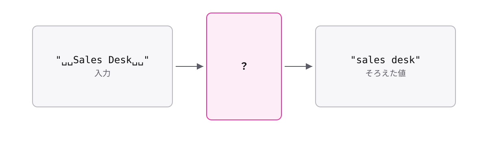
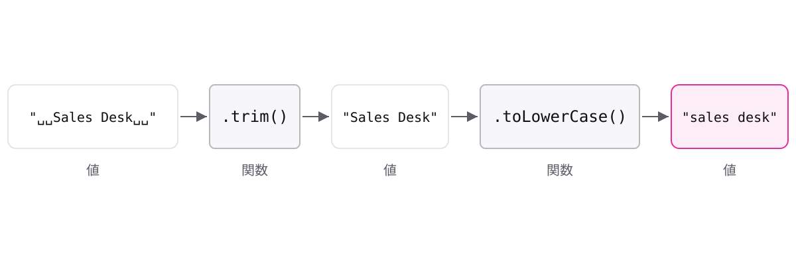
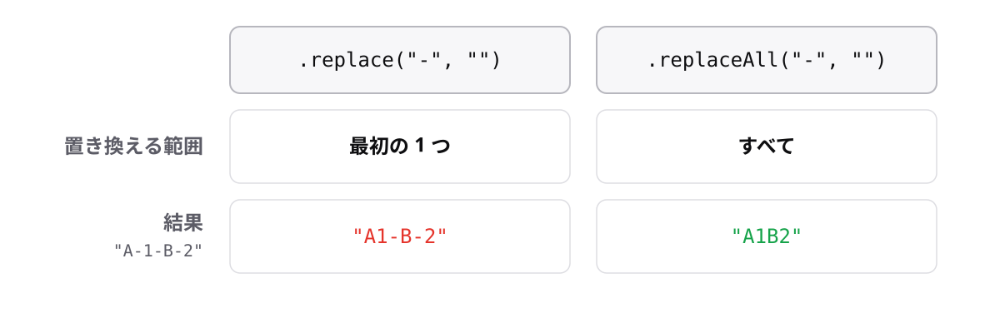

<!-- _class: lead -->
# 5-1-3 整える・置き換える

<!-- ノート: 入力された文字列の表記をそろえる方法と、文字を置き換える範囲を見ます。 -->

---

# 入力の表記を、そろえるには？



前後の空白と、英字の大きさをそろえます。

<!-- ノート: 部署名の入力を例に、空白を表す ␣ の印と、大文字の S と D を指します。 -->

---

# 覚えること



空白や大文字小文字をそろえ、置き換える範囲を選びます。

<!-- ノート: trim は前後の空白だけを取り除き、toLowerCase は英字を小文字にします。途中の空白が残ることを、図の値をたどって示します。 -->

---

# 書き方を読む

```ts
const input = "  Sales Desk  ";
console.log(input.trim().toLowerCase());
// 結果: "sales desk"
```

途中の空白は残ります。

<!-- ノート: 二つの操作は順に新しい文字列を返します。input に入っている元の文字列は変わりません。 -->

---

# 最初だけか、すべてか



文字列を渡した `replace` は、最初の 1 つだけです。

正規表現を使うと、探す文字の種類を表せます。

<!-- ノート: 正規表現は探す文字の種類や並びを表し、[0-9] は数字一文字、g はすべての一致を扱う指定です。"A-1-B-2" に .replace(/[0-9]/g, "") を使うと "A--B-" になります。 -->

---

<!-- _class: summary -->
# まとめ

空白や大文字小文字をそろえ、置き換える範囲を選びます。

<!-- ノート: 問9・問10・問18では、どの文字をどの範囲で変えるかを確かめて操作を選びます。 -->
