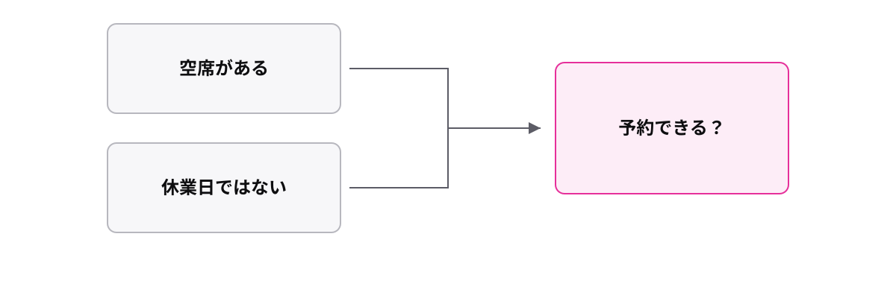
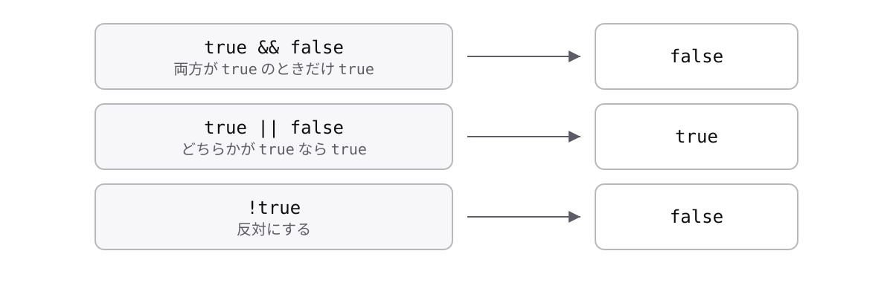
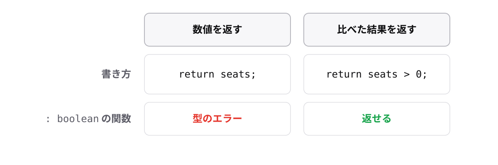

<!-- _class: lead -->
# 6-1-1 条件を組み合わせて返す

<!-- ノート: 予約の場面で、比べた結果から真偽を決める書き方を見ます。: boolean は true と false のどちらかを返す約束です。 -->

---

# 2 つの条件を、どう組み合わせますか？



空席があっても、休業日は予約できません。

<!-- ノート: 左の二つの箱から右へ矢印をたどります。空席だけを見た場合に、何を見落とすかを問いかけます。 -->

---

# 覚えること



比べた結果を組み合わせると、条件をそのまま返せます。

<!-- ノート: 比較は真か偽を作ります。図を上から指し、&&（かつ）は両方が真なら真、||（または）は少なくとも一方が真なら真、!（でない）は真偽を逆にすると補います。 -->

---

# 書き方を読む

```ts
const seats = 3;
const closed = true;
const canBook = seats > 0 && !closed;
console.log(canBook);
// 結果: canBook は false
```

比べた結果は、そのまま返したり入れたりできます。

<!-- ノート: seats > 0 は true ですが、休業日なので !closed は false です。&& で組み合わせた結果の false が canBook に入ります。 -->

---

# よくある間違い



比べる式にすると、true か false を返せます。

正規表現の `test` は、合う部分があるかを調べます。

<!-- ノート: 左の return seats は数値を返すので型のエラーになり、右は真偽を返せます。正規表現は探す文字の形を表し、test は文字列の一部でも合えば true を返します。 -->

---

<!-- _class: summary -->
# まとめ

比べた結果を組み合わせると、条件をそのまま返せます。

<!-- ノート: 問題の答えを写さず、使う値に合う書き方を選んでもらいます。どの比較が true や false を作るかを、式を読むときに確かめます。 -->
