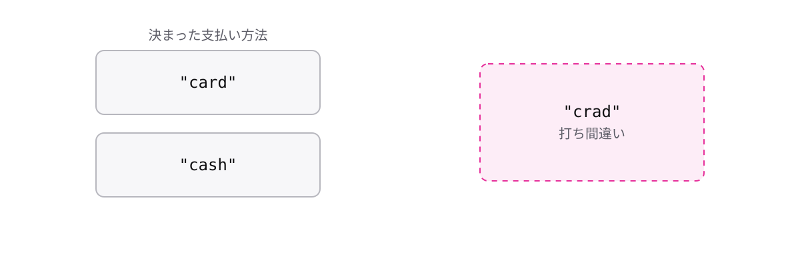
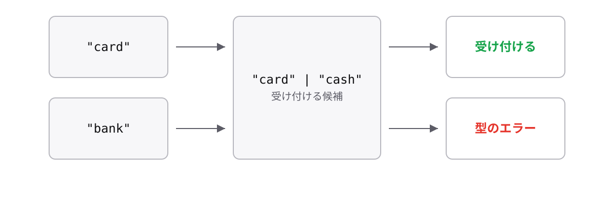
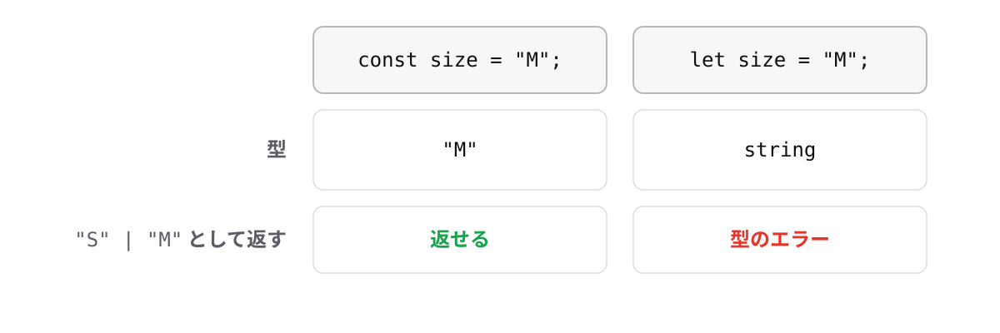

<!-- _class: lead -->
# 7-1-1 決まった値だけを受け付ける型

<!-- ノート: リテラル型は決まった値だけを受け付ける型です。支払い方法を例に、候補を決めて値を返す書き方を見ます。 -->

---

# 打ち間違いを、実行前に見つけるには？



支払い方法は、決まった値だけにしたいです。

<!-- ノート: 左の二つの支払い方法と右の入力を指します。どの文字が入れ替わったかを確かめます。 -->

---

# 覚えること



リテラル型で候補を決め、条件に合った値をその場で返します。

<!-- ノート: 型を 1 本の | でつなぐユニオン型は、候補のどれか一つを受け付けます。図の上下の矢印をたどり、"card" は候補にあり、"bank" は候補にないと確かめます。 -->

---

# 書き方を読む

```ts
function paymentLabel(method: "card" | "cash"): string {
  if (method === "card") { return "カード払い"; }
  return "現金払い";
}
// 結果: paymentLabel("cash") は "現金払い"
```

`if` の中で `return` すると、そこで関数が終わります。

<!-- ノート: "card" のときは if の中で "カード払い" を返して終わります。"cash" のときは if の中を通らず、次の return で "現金払い" を返します。 -->

---

# よくある間違い



`let` で作ると、型は `string` に広がります。

型の `|` は 1 本です。

<!-- ノート: 型注釈なしで const に入れた文字列の型はその値そのもので、let では string に広がるので図の狭い戻り値には使えません。let でも型注釈で候補を指定でき、型をつなぐ記号には || ではなく | を書きます。 -->

---

<!-- _class: summary -->
# まとめ

リテラル型で候補を決め、条件に合った値をその場で返します。

<!-- ノート: 問題の答えを写さず、使う値に合う書き方を選んでもらいます。受け付ける候補と、条件に合ったときに返す値を確かめます。 -->
