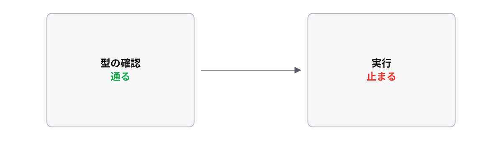
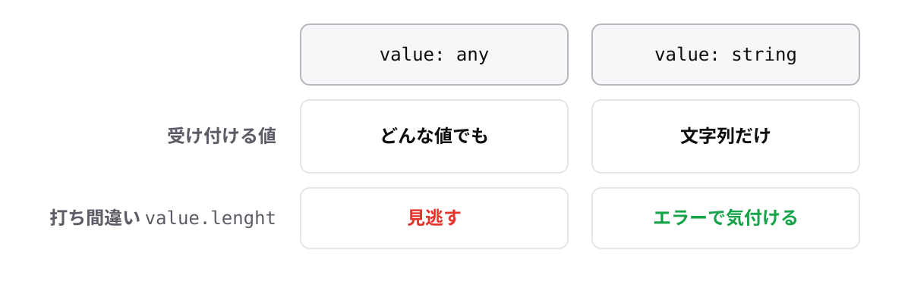
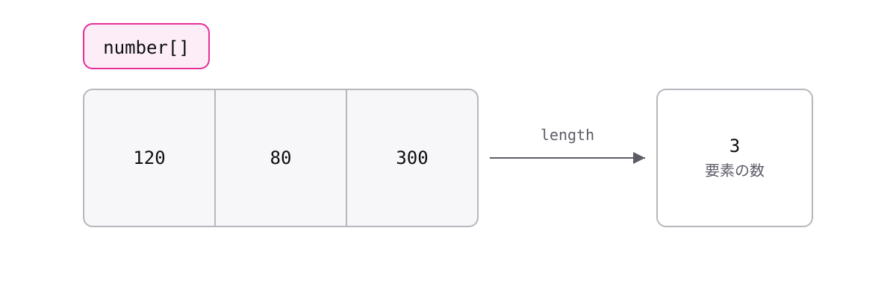

<!-- _class: lead -->
# 8-1-1 any をなくす

<!-- ノート: any はどんな値でもよい型です。具体的な型を選ぶと、値の使い方や名前の誤りに気付けます。 -->

---

# 確認は通ったのに、なぜ止まる？



型の確認を通ったのに、送料の表示が止まりました。

<!-- ノート: 左から右へ図をたどり、型を確かめるときと実行するときの結果を指します。どこで間違いに気付けるとよいかを問いかけます。 -->

---

# 覚えること



any を具体的な型に直すと、値の使い方の間違いを見つけられます。

<!-- ノート: プロパティは点の右の名前で、ここでは length を lenght と打ち間違えています。同じ間違いでも、any では見逃され、string では型の確認で気付けることを左右で見比べます。 -->

---

# 書き方を読む

```ts
const quantity = Number("120");
console.log(quantity + 1);
// 結果: 121
```

`Number()` は、文字列を数値に変えます。

<!-- ノート: 引用符のある "120" が数値の 120 になり、1 を足すと 121 になります。変換した値に合う型は number です。 -->

---

# 数値を並べた配列



`number[]` は、数値を並べた配列の型です。

文字列の `length` は読み取り専用です。

<!-- ノート: 配列の length は並んでいる値の数なので、三つのマスを数えると 3 です。文字列の length は読めますが、code.length = 8 のように入れ直すと型のエラーになります。 -->

---

<!-- _class: summary -->
# まとめ

any を具体的な型に直すと、値の使い方の間違いを見つけられます。

<!-- ノート: 問題の答えを写さず、使う値に合う書き方を選んでもらいます。型を決めるときは、受け取る値と返す値を確かめます。 -->
